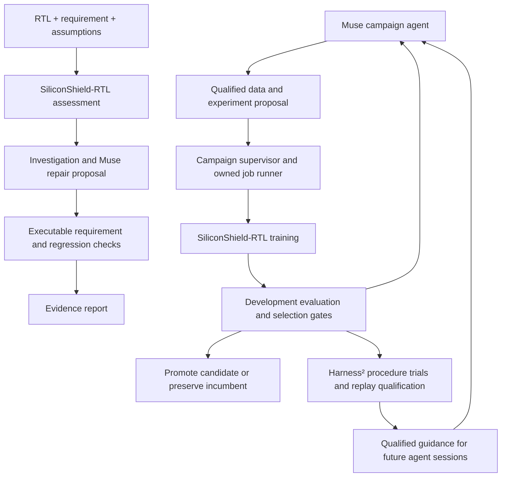

# SiliconShield

[](https://github.com/debjyotikm/siliconshield/actions/workflows/checks.yml)
[](docs/setup.md)
[](docs/siliconshield-rtl.md)
[](docs/README.md)

**Secure silicon before it ships.**

A register can behave correctly in a functional test and still let an
unauthorized request change protected state. SiliconShield helps an
engineer turn that security requirement into a checked finding and a
reviewable repair.

SiliconShield combines **SiliconShield-RTL Contract-1**, a locally
executable decision model, with **Meta Muse agents** and executable
verification. The workflow preserves the design, checks a suspected
violation, asks Muse for a candidate repair, and reruns the requirement
and regression checks. A second loop uses agents to prepare and analyze
training experiments for the specialist.

Contract-1 classified 191 of 192 fully specified development decisions
correctly, including 95 of 96 violations, with zero false-safe
predictions observed. It helps hardware engineers prioritize
simulation, formal verification, and review while keeping sensitive
designs on local hardware.

**Start with the [project brief](docs/project.md) and
[four-minute demo guide](docs/demo.md).** They explain the engineering
problem, Meta AI role, and how to check the results.

## Contents

- [Why SiliconShield](#why-siliconshield)
- [Headline results](#headline-results)
- [How it fits together](#how-it-fits-together)
- [Run an investigation in two minutes](#run-an-investigation-in-two-minutes)
- [What is implemented](#what-is-implemented)
- [Scope and evidence](#scope-and-evidence)
- [Code and guides](#code-and-guides)
- [References](#references)

## Why SiliconShield

A **triage decision** is a structured model judgment about one RTL
region under one explicit requirement. It tells the team where to
look next. **Verification** is what proves the finding with tool
evidence and engineering review.

SiliconShield lives between generic code analysis and full
verification. It offers requirement-aware triage where the same
implementation can receive different correct answers under different
requirements, then carries each finding through executable checks
and a reviewable repair.

The project has three parts:

- **SiliconShield-RTL Contract-1:** a specialized decision model
  trained on RTL, security requirements, and solver-validated labels.
  See the [model card](docs/siliconshield-rtl.md) and
  [measured limits](docs/LIMITATIONS.md).
- **Security investigation:** a workflow that connects model
  assessments, Muse repair proposals, executable checks, and
  evidence reports.
- **Autonomous training campaigns:** experiments that recover after
  interruption, with checkpoint selection, regression checks, and
  Harness² procedure learning.

## Headline results

Directly measured on balanced, group-disjoint development families:

| Metric | Contract-1 |
|---|---:|
| Fully specified decisions | 191 of 192 at 99.48 percent |
| Satisfying cases | 96 of 96 at 100 percent |
| Violating cases | 95 of 96 at 98.96 percent |
| False safe violations | 0 of 96 |
| Full three way accuracy | 257 of 288 at 89.24 percent |

Unseen qualification reaches 86.46 percent with zero false safes on
96 violations, while shifted evaluation records 43.65 percent. That
gap defines the measured operating envelope. Full matrices live in
[measured limits](docs/LIMITATIONS.md). Weights are published at
[Contract-1 on Hugging Face](https://huggingface.co/danieltombay/siliconshield-rtl-contract-1).

## How it fits together



The Muse campaign agent and the fine-tuned Glimmer operator are
distinct controller paths. A campaign can use the Muse coding agent
without depending on a locally served Glimmer adapter. See the
[architecture guide](docs/architecture.md) for their
responsibilities.

## Run an investigation in two minutes

Requires Python 3.11 or newer plus Verilator plus a C++ toolchain,
then:

```bash
python -m pip install -e .
python -m siliconshield.app --list
python -m siliconshield.app --case unauthorized-write \
  --output /tmp/siliconshield-demo
```

Expected conclusion is `demonstrated_violation_fixed` with
`repair_accepted` true. Read `/tmp/siliconshield-demo/report.md`
for the narrative and `report.json` for inputs, security
assessment, checks, patch, and conclusion. No weights are needed.
Without a checkpoint the report marks the model as unavailable and
still proves the workflow. For a live Muse repair, add
`--muse-endpoint` plus `--muse-model` as described in the CLI help.
The report records the proposer so authored and model repairs stay
distinct.

Prefer clicks. `python -m siliconshield.gui` opens the same
authored demos with Load Demo and Run Analysis. See the
[GUI guide](docs/gui.md). Current release demos read Should
satisfy and Should violate in the dropdown.

For a trained assessment, configure `SILICONSHIELD_SECURITY_PYTHON`
and `SILICONSHIELD_SECURITY_CHECKPOINT`, plus the compatible
runtime in [setup](docs/setup.md). Training, controller operation,
and inference use separate environments. Weights and training
datasets are not bundled.

## What is implemented

### Security analysis and repair

- CLI investigations for authored cases and custom SystemVerilog
  inputs.
- Checkpoint-bound model assessments with export-record question
  versions, artifact fingerprints, and explicit handling of
  unavailable models or truncated inputs.
- Desktop GUI with contract-aware persistent worker and Should
  satisfy and Should violate showcase pairs.
- Line-numbered relevant-statement extraction and Verilator checks.
- Muse patch proposals through a configurable chat endpoint. Exact
  replacement anchors are checked before a candidate is applied.
- Re-verification of candidate repairs and JSON plus Markdown
  evidence reports.
- Authored examples covering unauthorized writes, debug lock
  bypass, legitimate access, and missing context.

### Security-model training

- Dataset builders for local hardware contracts, mutations,
  equivalent rewrites, requirement counterfactuals, and
  missing-context examples.
- Source-backed extraction machinery for OpenTitan and
  HardSecBench material. Experiment catalogs and source checkouts
  are supplied separately.
- A fixed checker that compiles proposed RTL with Icarus and uses
  Yosys SAT with declared per-contract bounds to establish labels.
  Missing context requires verified completions with opposing
  outcomes.
- Versioned question contracts with export-record inference, plus
  an independent review ledger for English-to-assertion mapping.
- Immutable dataset versions, content hashes, lineage and overlap
  checks, broad and narrow pilot release classes, and explicit
  training-acceptance records.
- BF16 distributed training with single-backward DDP guard,
  residual adapters, configurable encoder freezing, sampling pools
  with delivered exposure, and an optional frozen-teacher
  preservation loss.
- Checkpoint selection across multiple development populations,
  including false-safe limits, class recall, paired decisions,
  retention, and NLL.
- Resumable optimizer and RNG state, checkpoint exports, and
  separate calibration and final evaluation.

A **false-safe** is a real requirement violation labeled as
satisfying the requirement. Selection can reject a candidate that
improves overall accuracy while increasing these errors in a
protected population.

### Unattended campaigns with Muse

The campaign supervisor coordinates successive experiments through
a durable state machine. The Muse coding agent analyzes results,
proposes the next hypothesis, prepares qualified training material,
or recommends stopping. The supervisor checks the proposal and
records which training job it starts.

Each round records its parent model, dataset, recipe, selection
rules, and reporting configuration. Job records let the supervisor
reconnect after an interruption and check that results belong to
the right experiment. The latest training weights, selected
checkpoint, and accepted incumbent are kept separately.

Research promotion and deployment acceptance are separate
decisions. A failed round retains its evidence and leaves the
incumbent intact. Policy changes are explicit and recorded.
Repeated failure can end the campaign.

### Glimmer training and Harness² procedure learning

Muse Glimmer has a separate training path for evidence handling
and bounded operator decisions such as continue, leave unchanged,
stop, adjust learning rate, resume, and retry finalization. The
repository includes LoRA supervised fine-tuning, offline DPO,
signed episode splits, arithmetic and final-response grading, and
per-action regression checks for adapter selection.

Harness² improves **instructions**, separately from model weights.
Its Muse integration proposes prompt guidance, tests it on replay
tasks, qualifies it against a separate development population, and
publishes passing guidance for future supervisor sessions. Replay
tools cannot launch training jobs.

Inference tools include a Transformers reference server and a
native vLLM launcher with optional DFlash speculation. Both check
model identity and GPU ownership. Timing tools measure prefill and
decoding separately.

## Scope and evidence

The implementation and regression tests cover training,
orchestration, verification, and recovery behavior. Model accuracy
belongs to a specific checkpoint, dataset split, and inference
configuration. Aggregate measurements for Contract-1 are reported
with failure cases in [model limitations](docs/LIMITATIONS.md).
They do not imply general hardware-security coverage.

The decision model is requirement-conditioned. CWE identifiers in
source provenance do not establish a trained general CWE
classifier. Relevant-statement extraction is not a validated
neural vulnerability-localization head. Formal labels are limited
to the checker registered assumptions and supported RTL. They do
not certify an entire chip or physical implementation.

Private campaign results, datasets, checkpoints, transcripts,
credentials, and machine configuration remain outside Git. Public
examples are authored fixtures. They are not the experiment
corpus.

## Code and guides

| Area | Implementation | Guide |
|---|---|---|
| Investigation and repairs | [`app/`](siliconshield/app/), [`agents/`](siliconshield/agents/) | [Examples](examples/README.md) |
| Desktop analysis | [`gui/`](siliconshield/gui/) | [GUI guide](docs/gui.md) |
| Security-model training and data | [`training/laya/`](siliconshield/training/laya/) | [Training guide](siliconshield/training/laya/README.md) |
| Glimmer fine-tuning and selection | [`training/glimmer/`](siliconshield/training/glimmer/) | [Glimmer guide](docs/glimmer.md) |
| Campaigns and job ownership | [`research_loop/execution/`](siliconshield/research_loop/execution/) | [Architecture](docs/architecture.md) |
| Harness² and Muse procedures | [`research_loop/procedures/`](siliconshield/research_loop/procedures/) | [Procedure learning](docs/muse-procedures.md) |
| Serving and controller evaluation | [`research_loop/controller/`](siliconshield/research_loop/controller/) | [Inference](docs/inference.md) |
| Installation and configuration | [`configs/`](configs/), [`deploy/`](deploy/) | [Setup](docs/setup.md) |
| Regression tests and checks | [`tests/`](tests/), [`tools/`](tools/) | [Contributing](CONTRIBUTING.md) |

SiliconShield-RTL builds on the LAYA checkpoint and runtime, with
residual adapters and security-specific training. That foundation
remains explicit in the [model card](docs/siliconshield-rtl.md)
and [NOTICE.md](NOTICE.md).

## References

- [Meta Muse Glimmer](https://huggingface.co/meta-models/Muse-Glimmer-30B)
- [Muse Glimmer post-training](https://dev.meta.ai/docs/muse-glimmer/post-training)
- [Google Research Harness²](https://github.com/google-research/harness2)
- [OpenTitan](https://github.com/lowRISC/opentitan)
- [HardSecBench](https://github.com/chenqirui2002/HardSecBench)
- [LAYA foundation](https://github.com/NandhaKishorM/laya) and
  [LAYA Next runtime](https://github.com/debjyotikm/laya-next)
