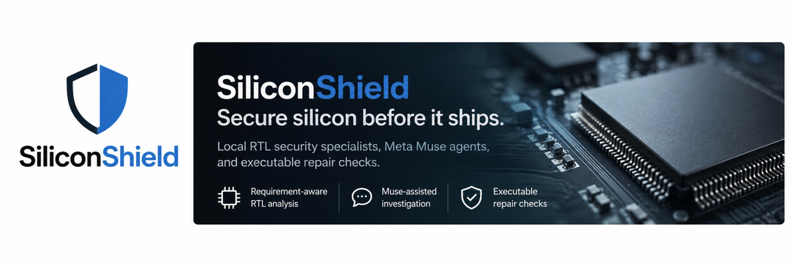
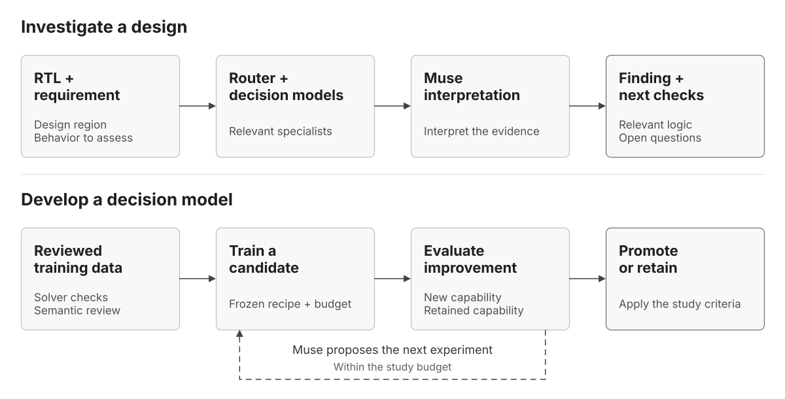

<div align="center">
  

  <p><strong>RTL bug investigation. Contract skills for Muse Glimmer. Measured evidence.</strong></p>

  <p>
    <a href="https://github.com/debjyotikm/siliconshield/actions/workflows/checks.yml"></a>
    <a href="docs/setup.md"></a>
    <a href="LICENSE"></a>
  </p>

  <p>
    <a href="#get-started">Get started</a> ·
    <a href="#contract-skills">Contract skills</a> ·
    <a href="docs/README.md">Engineering documentation</a>
  </p>
</div>

Every AI solution depends on the chips - processors, accelerators, and memory
systems beneath it. SiliconShield brings AI investigation to the hardware that
powers AI. It evaluates RTL against explicit requirements through a capability
router that consults Muse Glimmer through the Contract-1 and Contract-2
specialist skills. Muse interprets the resulting verdicts against the
implementation, producing a finding with supporting excerpts and open
questions. The goal is to help hardware engineers focus their effort where
it matters.

The platform provides the data, evaluation, and recovery infrastructure to
improve the specialists or develop skill coverage for another design domain.
Investigation and improvement share the same principle: an apparently
convincing answer must remain distinguishable from an independently
checked result.

Model conclusions guide RTL review and investigation. Simulation and repair
checks run through a separate application that records what was executed.
The [research white paper](docs/whitepaper.md) traces the specialist
capabilities, datasets, and measured failure modes behind the system.

## Three Ways to Use SiliconShield

1. **Investigate RTL with Muse Glimmer and the Contract skills.** Assess
   a design against its functional or security requirement. The router sends
   the design to Glimmer with the relevant specialist skill, and Muse
   examines the verdicts alongside the RTL to explain suspected mismatches,
   disagreements, and missing context.

2. **Use the Contract skills directly.** Integrate Contract-1 and Contract-2
   into existing engineering tools through the CLI and Python interfaces.
   Obtain structured verdicts, scores, and skill identity without an agent
   session in the inference path.

3. **Improve the specialists.** Refine skill coverage using qualified
   datasets, reproducible evaluation, and explicit acceptance criteria.
   Measure every change against what must improve and what must be
   preserved.

## Contract Skills

**Give agents specialist RTL judgment they can call as a tool.** The
Contract skills let Muse Glimmer assess a design against an explicit
requirement and return a structured result: **satisfies the requirement**,
**violates the requirement**, or **insufficient context**. The router
selects the relevant skill, Glimmer applies its domain procedure to the
RTL, and Muse interprets the verdicts to focus the investigation on the
logic that matters. Each skill carries versioned domain knowledge, so new
specialists can extend the workflow to additional design domains.
Both skills were developed with the help of Muse Wonder and Muse Spark 1.3,
distilling specialist judgment captured in the project's datasets.

### Contract-1 · Local guards and register protection

Contract-1 is a specialist skill for the control logic that protects
register and state updates. Its strength is assessing **visible privilege
checks, lock guards, clear enables, and address qualification** in a
self-contained RTL region.

It helps agents investigate questions such as: *Can an unprivileged request
change this register? Does a clear operation require authorization? Can an
update occur outside the permitted address range?* By reading the
implementation together with the requirement, Contract-1 gives the agent a
focused assessment of whether the relevant guard enforces the intended
policy.

### Contract-2 · FIFO, counter, and arbitration behavior

Contract-2 is a specialist skill for **focused state-transition
requirements** in FIFOs, counters, and arbitration logic. It extends the
workflow from local access guards to questions about how control state
responds to requests, boundaries, and competing operations.

Its strongest demonstrated areas include FIFO occupancy control and counter
behavior. It helps agents examine questions such as: *Does a push while full
preserve occupancy? Does a saturating counter stop at its limit?* Focused
arbitration support adds assessment of grant and handshake behavior. Each
question is evaluated against the supplied RTL and its stated operating
assumptions.

[Inspect the Contract-1 skill](.agents/skills/contract-1/SKILL.md) ·
[Inspect the Contract-2 skill](.agents/skills/contract-2/SKILL.md) ·
[Route through Glimmer](docs/router.md#glimmer-specialists)

## Models used

SiliconShield calls Meta models for investigation and assessment. The
shipped skill path returns verdicts from Meta Muse Glimmer.

| Model | Made by | Where it runs | What it does here |
|---|---|---|---|
| Muse Glimmer 30B | Meta | Local vLLM server on DGX Spark | Specialist verdicts through the Contract-1 and Contract-2 skills, and investigation sessions |
| Muse Spark 1.3 | Meta | Through the Muse CLI | Final assessment over specialist evidence |

## RTL Investigation

SiliconShield brings the Contract skills and Muse together to investigate
RTL against an explicit requirement and identify the next engineering checks.



[System architecture](docs/architecture.md)

### Investigate a design with Muse

**Start with the behavior you need to protect.** Supply an RTL region and a
requirement, such as preventing unauthorized register writes or preserving
FIFO occupancy under backpressure. The router sends the case to Glimmer
with the skills that cover the relevant domain.

Muse interprets the resulting verdicts alongside the design and
requirement, identifies relevant logic, and explains disagreements or
missing information. The result is a structured finding that helps an
engineer decide **where to look, which requirement is at risk, and what to
check next**.

[Explore the investigation workflow](docs/router.md)

### Improve the specialists for your design domain

**Extend the analysis as your hardware changes.** The Contract skills build
on qualified datasets that capture specialist RTL judgment. Reproducible
evaluation measures what improves and what must be preserved, under
explicit acceptance criteria.

Candidate skill revisions are measured against those criteria before
adoption. Experiments that fail to improve remain as evidence for the next
revision. This gives teams a controlled path from an observed specialist
weakness to a measured capability gain.

## Muse Analysis

**Match each RTL question to the right specialist skill.** A register-access
requirement and a FIFO-control requirement call for different expertise.
SiliconShield uses the declared design domain and measured skill
capabilities to select relevant specialists, bringing their verdicts into
a common investigation workflow.

Muse interprets those verdicts against the RTL and the stated requirement.
The [RTL analysis skill](.agents/skills/rtl-analysis/SKILL.md) guides its
attention to register writers, branch guards, competing updates, and hidden
dependencies. It also distinguishes functional defects from security failures
by identifying the intended behavior or protection property at risk.

Each result stays linked to the assessed input and the skill that produced
it. Specialist disagreements, gaps in skill coverage, and failed calls
remain visible, so engineers can understand what supports a finding and
what still needs investigation. Muse brings this evidence together into a
traceable assessment with relevant RTL references and next checks.

## How the Contract Skills Work

**Specialist knowledge that Muse Glimmer applies on demand.** Each Contract
skill encodes the domain procedure behind one specialist: which RTL
patterns it judges, how it traces behavior, and when it must answer
insufficient context instead of guessing. Glimmer reads the skill, applies
it to the supplied design and requirement, and returns a verdict with
evidence and open questions.

### Versioned domain knowledge

Every specialist request pins the exact skill content it used. The router
records skill digests alongside the served-model fingerprint, so each
receipt shows which skill version judged which input. Skill revisions are
adopted only after measured evaluation against the study acceptance
criteria.

### Same router flow, Meta models throughout

The router validates skill verdicts through the same checks as any other
specialist: result shape, routing scope, and capability profile. Low
confidence verdicts are refused rather than reshaped. Muse Spark 1.3 then
gives the final assessment over the specialist evidence.

### Demonstrated on local hardware

The workflow has been exercised with **Muse Glimmer serving on NVIDIA DGX
Spark**. Documented runs cover the Contract-1 access-control skill, the
Contract-2 temporal skill, and the Spark final assessment, each with
receipts carrying skill digests and the served-model fingerprint.

## Get started

Complete [environment setup](docs/setup.md), then activate the controller
environment from the repository root:

```bash
source .venv-controller/bin/activate
```

Every command below calls Meta models only: Muse Glimmer gives specialist
verdicts through the Contract-1 and Contract-2 skills, and Muse Spark 1.3
gives the final assessment.

Start Glimmer using [local deployment](docs/inference.md). Set
`SILICONSHIELD_MUSE_ENDPOINT` to its loopback chat endpoint. These commands
use the served model name `glimmer-base`. If it runs on another machine, add
`--ssh-host YOUR_SSH_ALIAS` and use the endpoint on that host. Register the
specialists per [Glimmer specialists](docs/router.md#glimmer-specialists) and
point `GLIMMER_REGISTRY` at that registry.

### 1. Contract-1 skill: register privilege protection

[The design](examples/rtl/privilege-register.sv) updates `cfg_reg` only when
both the write enable and privilege input are asserted. Reset is exempt.

```bash
python -m siliconshield.research_loop.procedures.glimmer_specialists \
  --registry "$GLIMMER_REGISTRY" --scope ot-access-control \
  --design examples/rtl/privilege-register.sv \
  --requirement "Outside reset, cfg_reg may change only when privileged is asserted." \
  --assumptions "Two-state synchronous logic. Inputs are defined and may vary independently. Reset is exempt from the requirement." \
  --endpoint "$SILICONSHIELD_MUSE_ENDPOINT" --model glimmer-base \
  --glimmer-fingerprint "$GLIMMER_FINGERPRINT" \
  --output ./receipt-1a --brief
```

### 2. Contract-2 skill: simultaneous push and pop

[The design](examples/rtl/push-pop-count.sv) increments `count` when push and
pop are both asserted. This conflicts with the requirement that simultaneous
requests leave the count unchanged.

```bash
python -m siliconshield.research_loop.procedures.glimmer_specialists \
  --registry "$GLIMMER_REGISTRY" --scope counter \
  --design examples/rtl/push-pop-count.sv \
  --requirement "Outside reset, when push and pop are both asserted, count must remain unchanged." \
  --assumptions "Two-state synchronous logic sampled at the rising clock edge. Reset is exempt from the requirement. Inputs may vary independently." \
  --endpoint "$SILICONSHIELD_MUSE_ENDPOINT" --model glimmer-base \
  --glimmer-fingerprint "$GLIMMER_FINGERPRINT" \
  --output ./receipt-1b --brief
```

Both commands print the prediction, all three scores, and inference time,
and write a receipt with skill digests, fingerprint, and verdicts.

### 3. Spark final assessment

With the Muse CLI installed and signed in, add `--arbitrate` to either
command. This sends the RTL, requirement, assumptions, and specialist
evidence to Muse Spark 1.3 for the final assessment. This example uses
[this design](examples/rtl/push-pop-hold.sv), where simultaneous push and
pop take the default branch and leave `count` unchanged:

```bash
python -m siliconshield.research_loop.procedures.glimmer_specialists \
  --registry "$GLIMMER_REGISTRY" --scope counter \
  --design examples/rtl/push-pop-hold.sv \
  --requirement "Outside reset, when push and pop are both asserted, count must remain unchanged." \
  --assumptions "Two-state synchronous logic sampled at the rising clock edge. Reset is exempt from the requirement. Inputs may vary independently." \
  --endpoint "$SILICONSHIELD_MUSE_ENDPOINT" --model glimmer-base \
  --glimmer-fingerprint "$GLIMMER_FINGERPRINT" \
  --output ./receipt-2 --arbitrate --brief
```

`--brief` displays the specialist verdicts and Muse's conclusion and
explanation without local absolute paths. Omit `--brief` for the full JSON
report. Model conclusions remain predictions, with execution errors
reported separately.

### Same cases on Muse API models

With the Muse CLI installed and signed in, the same three designs run
behind the same Contract skills on `muse-spark-1.3` or `muse-wonder-1.0`
(or any model id your account can access) instead of the served
endpoint. Scope routing needs measured profiles, so each call names
its expert directly:

```bash
python -m siliconshield.research_loop.procedures.muse_specialists \
  --registry "$GLIMMER_REGISTRY" --expert contract-1 \
  --design examples/rtl/privilege-register.sv \
  --requirement "Outside reset, cfg_reg may change only when privileged is asserted." \
  --assumptions "Two-state synchronous logic. Inputs are defined and may vary independently. Reset is exempt from the requirement." \
  --model muse-spark-1.3 --output ./receipt-spark-1a --brief
```

Replace `--expert` and `--design` with the `contract-2` cases above to
repeat them. Provider-managed weights have no locally verifiable
digest, so receipts record the checked skill digest with an explicit
provider-managed identity instead of checkpoint hashes or borrowed
capability claims.

[Browser demo](docs/web-demo.md) · [Router and Python API](docs/router.md)

## Research Bonus

### Fine-tuned Muse Glimmer for RTL decisions

**One Muse Glimmer adapter, two hardware-design domains.** Alongside the
Contract skills, we fine-tuned Muse Glimmer 30B to assess local register
protection and focused FIFO, counter, and arbitration requirements. The
[SiliconShield Muse Glimmer RTL adapter](https://huggingface.co/debjyotikm/siliconshield-muse-glimmer-rtl-lora)
takes RTL, an English requirement, and execution assumptions, then returns
scores for **satisfies requirement**, **violates requirement**, and
**insufficient context**.

The release documents development performance and known limits. These
measurements are not independent qualification or proof of RTL correctness.
The frozen adapter also passed all six authored demonstrations, including a
missing privilege guard and an incorrect simultaneous push/pop update.

The study used **3,276 available training examples** from the existing
specialist datasets. The selected checkpoint received **1,194 examples over
199 optimizer updates** on three NVIDIA RTX PRO 4000 Blackwell GPUs. Only
low-rank adapter weights were trained. The published adapter is approximately
183 MiB and requires the original Muse Glimmer 30B model.

**Use it as a focused decision tool.** The browser demo can serve this
adapter through a scoring transport with newly measured capability
profiles: verdicts come from normalized answer-token scores in a
fraction of a second, and final assessment still runs on Muse Spark.
The release also includes a standalone local scoring script.
The tested loader uses three CUDA GPUs.

**Model disclosure.** The adapter is a LoRA fine-tune of Meta Muse
Glimmer 30B. Meta supplies the frozen base model, used unmodified
under Apache-2.0. The custom adapter weights were trained for this
project during the hackathon. They are not a Meta model. The method,
data, and measured limits are linked above.

[Model and loading instructions](https://huggingface.co/debjyotikm/siliconshield-muse-glimmer-rtl-lora)
· [Training and dataset construction](https://huggingface.co/debjyotikm/siliconshield-muse-glimmer-rtl-lora/blob/main/docs/training-guide.md)

**Explore the research data.** The broader
[training collection](https://huggingface.co/datasets/debjyotikm/siliconshield-rtl-training)
contains **19,050 rows**, and the
[development benchmark](https://huggingface.co/datasets/debjyotikm/siliconshield-rtl-benchmark)
contains **5,589 decisions across 11 RTL areas**. These collections include
other research stages and follow-up studies. They are not the exact training
subset or an independent final test for this adapter.

## Engineering references

Browse the [documentation index](docs/README.md) for recommended reading paths,
or go directly to a guide below.

| Area | Documentation |
|---|---|
| Getting started | [Environment setup](docs/setup.md) · [Demo setup and walkthrough](docs/web-demo.md) · [Example formats](examples/README.md) |
| RTL investigation | [Requirements and RTL examples](docs/rtl-requirements.md) · [Router and API](docs/router.md) · [Command and configuration reference](docs/reference.md) |
| Architecture | [System architecture](docs/architecture.md) · [Architecture diagrams](docs/diagrams/README.md) |
| Contract skills | [Contract-1 skill](.agents/skills/contract-1/SKILL.md) · [Contract-2 skill](.agents/skills/contract-2/SKILL.md) · [Glimmer specialists](docs/router.md#glimmer-specialists) |
| Model training | [Glimmer training guide](docs/training-guide.md) |
| Local Muse Glimmer | [Deployment and qualification](docs/inference.md) |
| Research | [Scientific white paper](docs/whitepaper.md) · [Measured limitations](docs/LIMITATIONS.md) |
| Development | [Contributing](CONTRIBUTING.md) |
| Agent skills: investigation | [RTL analysis](.agents/skills/rtl-analysis/SKILL.md) · [Glimmer routing](.agents/skills/glimmer-router/SKILL.md) · [Contract-1](.agents/skills/contract-1/SKILL.md) · [Contract-2](.agents/skills/contract-2/SKILL.md) |
| Agent skills: training | [Study design](.agents/skills/study-design/SKILL.md) · [Glimmer studies](.agents/skills/glimmer-study/SKILL.md) · [Round diagnosis](.agents/skills/round-diagnosis/SKILL.md) · [Campaign operations](.agents/skills/campaign-ops/SKILL.md) |

Repository code is **[Apache-2.0](LICENSE)**. Model weights and datasets have
separate terms. See [NOTICE](NOTICE.md) for dependency licenses and attribution.

**Upstream projects and models:**
[Meta Muse models](https://dev.meta.ai/docs/models) ·
[Muse Glimmer 30B](https://huggingface.co/meta-models/Muse-Glimmer-30B)

## Built with Muse

This repository was built with [Meta Muse](https://dev.meta.ai/docs/models).
Muse Spark 1.3 and Muse Wonder models, working through Muse Code and
OpenCode agentic coding sessions, were used to build the infrastructure:
studies, the expert router, agent skills, and evaluation tooling. They
developed the Contract-1 and Contract-2 skills, supported the training
studies on local GPU hardware.
