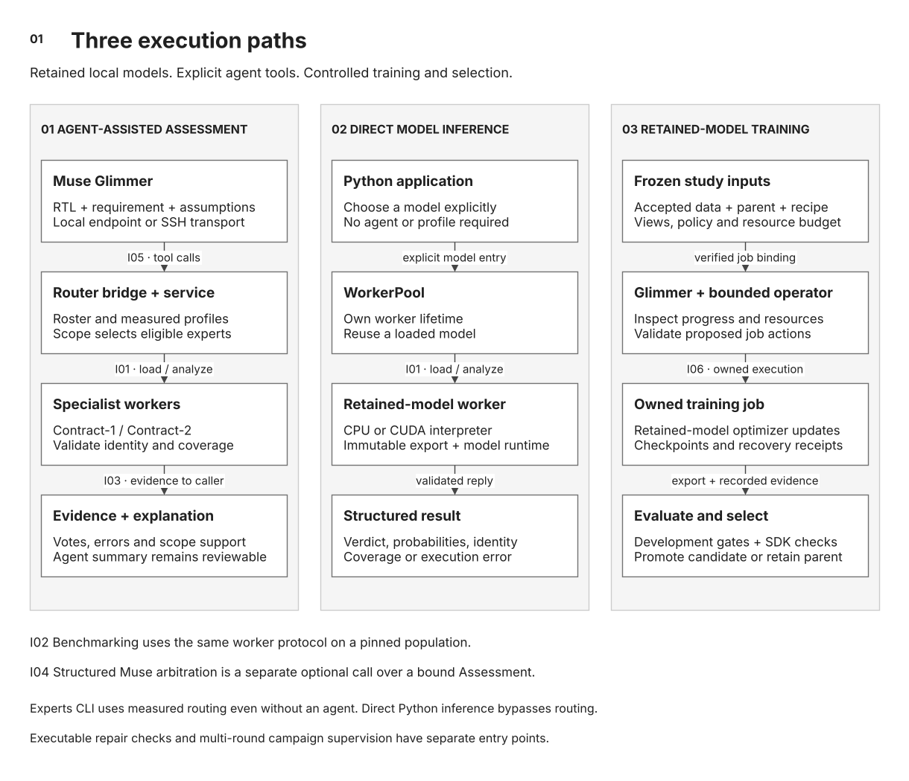

# System architecture

[Documentation](README.md) / Architecture specification

| Scope | Baseline | Related specifications |
|---|---|---|
| Implemented application, inference, and training boundaries | Current repository interfaces and serialized contracts | [Assessment](router.md) · [Studies](decision-study.md) · [Wire and artifact contracts](reference.md) |

SiliconShield combines requirement-conditioned RTL assessment with a controlled
model-improvement system. Contract-1 and Contract-2 are independently trained
RTL decision models. The application routes a declared design scope to suitable
models, preserves their evidence, and can request a Muse interpretation. A
separate investigation path executes requirement checks and tests proposed repairs.

The training system uses accepted datasets, frozen study inputs, owned jobs,
and explicit selection constraints. Model quality, execution completion, and
campaign promotion have separate records and acceptance conditions.

## Functional correctness and security scope

A configuration register can pass a basic write test while allowing an
unprivileged requester to change protected state. That guard failure contradicts
an authorization policy. A FIFO count can violate a hold requirement under
backpressure, but its security impact depends on how the system uses the FIFO
and whether an attacker can affect availability or an isolation boundary.

The caller supplies that requirement and threat context. Contract-1 assesses
visible local guards, while Contract-2 assesses focused FIFO, counter, and
arbitration transitions. Neither release establishes clock-domain-crossing,
whole-block, or whole-chip correctness. A model label prioritizes a check. It
does not establish a counterexample or exploitability.

## 1. Runtime decomposition

**Figure 01.** Application and inference boundaries. I01–I04 are defined below.
[Open full-size SVG](diagrams/system-overview.svg) ·
[Editable draw.io source](diagrams/siliconshield-architecture.drawio)

The control application does not import the model's Torch environment. It starts
an owned Python worker using the registry's interpreter and runtime. Model
execution stays inside that worker. Experts CLI, Python integrations, and
benchmark code share contracts while retaining different application behavior.

| Runtime element | Responsibility | Lifetime and ownership |
|---|---|---|
| Experts integrator | Supply scope and state, instantiate `InferenceService`, provide worker transport, and optionally request arbitration. | CLI owns workers for one invocation. Python integrations can retain a `WorkerPool`. |
| Model worker | Verify the export, resolve question bytes, load the model, score complete inputs, and return execution identity. | One subprocess per loaded expert. Calls to that worker are serialized. |
| Muse integration | Interpret expert evidence or propose a repair through the applicable interface. | Explicit agent call. The configured backend can be outside the local host. |
| Investigation engine | Execute registered checks, prepare a candidate copy, rerun checks, and write the engineering report. | One invocation with a caller-selected output directory. |
| Training deployment | Supply the service driver, profiles, evaluator callback, and immutable source snapshot. | Supervisor and systemd-owned jobs can outlive a client session. |

The experts API performs multi-model consultation. Lexical inspection is a
helper for the caller. It neither infers the CLI scope automatically nor
elaborates SystemVerilog. A client remains responsible for choosing a complete
region and declaring the property scope.

## 2. Interface schedule

| ID | Boundary | Contract | Failure behavior |
|---|---|---|---|
| **I01** | Expert application ↔ worker process | Newline-delimited JSON over local pipes, protocol `1`. Load and analyze requests carry request identity. Replies bind model/session, input, coverage, and scores. | Timeout, malformed reply, identity mismatch, or truncation becomes an expert error. No synthetic label is substituted. |
| **I02** | Benchmark → model worker | The shared load/analyze protocol invokes one selected model on a pinned population. | Failed rows remain in support, and execution coverage is reported separately from accuracy. |
| **I03** | Worker evidence → assessment | `Assessment` preserves planned routing, successful responses, errors, and recomputed effective routing. | A failed expert loses its contribution to effective coverage. Thin evidence remains visible. |
| **I04** | Assessment → optional Muse arbitration | Same state, full requirement, assumptions, request/scope identity, and validated expert evidence. | Incompatible evidence refuses arbitration. CLI reports `arbitration_error` alongside the preserved assessment. |

The exact fields, score tolerances, deadline defaults, and schema owners are in
[the interface reference](reference.md#decision-and-worker-contracts).
Figure 02 in [the router specification](router.md#assessment-transaction)
shows message ordering, including cold load and partial failure handling.

`InferenceService` returns records to its caller. It does not persist an
assessment database. The CLI prints JSON, and the integrator chooses storage.
A finding is explicitly a `model_assessment`. Executable evidence belongs to
the investigation application's separate result contract.

## 3. Data and artifact ownership

| Artifact class | Binding | Mutation rule |
|---|---|---|
| Model export | Weights, full export manifest, question record, and runtime/inference identity | Load immutable generations. Register and qualify an upgrade as a new identity. |
| Capability profile | Expert/release identity, mechanism coverage, measured area counts, benchmark hash, execution identity | Re-measure when model or inference identity changes. Tiers are derived from counts. |
| Dataset version | Split bytes, lineage audit, semantic review, pools, and acceptance record | New rows, pools, or audit bindings require a new accepted version. |
| Study manifest | Parent, data, source, runtime, effective settings, views, policy, command, and budget | A changed bound input requires an explicit study amendment. |
| Run and round receipts | Owned job, attempts, phase/history, evaluated export, results, decision, and transaction state | Append or atomically replace through the owning API. Preserve evidence needed for recovery. |
| Reserved evaluation | Declared population identity and use history | Access only under its separate frozen evaluation protocol. No feedback into the same training study. |

Datasets, checkpoints, profiles, transcripts, and run evidence live outside the
source checkout. Public model and dataset releases are separate Hub artifacts.
The repository contains implementation, illustrative configurations, and tests.

Two identity levels are relevant. The export manifest identifies artifact bytes.
The observed execution identity also names question construction, runtime Python
code, backend/precision, Torch version, device type, batch behavior, token budgets,
and option order. A matching weights hash alone is insufficient for a matched
model comparison.

## 4. Training control and recovery

The [round lifecycle](campaigns.md#round-lifecycle) is persisted by
`laya_campaign.py`. The supervisor coordinates analysis and proposals. `Operator`
and `security_jobs` own preparation, submission, reconciliation, and recovery.
A deployment provides the polling/service loop and an evaluator callback.

For study-bound work, validation occurs at supervisor commit, operator prepare,
operator submit, and owned-worker execution. Each attempt reserves timeout plus
stop grace against the durable study budget. Shared resource locks coordinate
cooperating jobs that use the same resource root.

Selection within the trainer and promotion within a campaign are different
transactions. The trainer can retain initialization or select a checkpoint
that preserves protected views but misses a new quality target. Round assessment
recomputes metrics from aligned predictions and requires the full frozen gates
before accepting an improvement.

Promotion writes a durable intent before changing the incumbent. Recovery
revalidates the candidate and completes the same recorded decision. It does not
invent a new comparison after a partial write. The previous incumbent remains
the reference for that transaction.

| Event | Required system response | Implementation / regression coverage |
|---|---|---|
| Worker emits progress indefinitely | Honor the original request deadline and invalidate the failed worker generation. | `experts/worker.py` · [expert safety tests](../tests/test_expert_safety.py) |
| Strongest planned expert fails | Return its error and rerank only surviving evidence. | `experts/service.py` · [expert safety tests](../tests/test_expert_safety.py) |
| Submission client disappears | Reconcile the recorded systemd unit and receipts before any further submission. | `execution/operator.py` · [operator tests](../tests/test_operator.py) |
| Prepared data, policy, or command changes | Refuse the bound launch or assessment until a reviewed specification is registered. | `execution/study_contract.py` · [study enforcement tests](../tests/test_study_enforcement.py) |
| Crash during promotion or report closeout | Resume from transaction/phase evidence and revalidate the export before completing. | `execution/laya_campaign.py` |

Full operational procedures are in [operations and recovery](operations.md).
Locks and identity checks coordinate trusted processes. Host/container isolation
remains a deployment responsibility.

## 5. Agent authority

Muse has several independent integration roles. They share neither automatic
launch authority nor a single model-quality claim.

| Integration | Permitted output | Enforced boundary |
|---|---|---|
| Assessment arbitration | Model conclusion, evidence references, dissent, open questions | Input, requirement, and assessment identity |
| Glimmer router session | Roster queries, assessment requests, and a conversational summary | Operator-bound registry and validated expert tool results. Final prose is not passed through the structured arbitration validator. |
| Repair proposal | Exact replacements or a candidate RTL body | Patch validation and the same executable checks on a separate copy |
| Research supervisor | Diagnosis, round proposal, recovery plan, or justified stop | Study pins, accepted data, job ownership, budget, and promotion policy |
| Glimmer operator | Six bounded job actions | One authorized experiment and its intervention budget |
| Harness² | Replay-qualified procedural advice | Guidance does not modify policy, execute plugins, or train decision weights |

The coding-agent supervisor is independent of a served Glimmer adapter. The
implemented [Glimmer router bridge](router.md#driving-assessments-from-glimmer)
lets a local model request specialist assessments. It calls the experts path
without CLI arbitration and returns a conversation trace. Evidence validation
applies to each tool result, while the final prose still requires review.
That integration does not qualify Glimmer for every agent role.
Harness² is an optional procedure-learning path. A study that pins its guidance
bundle must explicitly adopt a changed generation. Unbound future sessions can
consume newly qualified guidance under their own configuration.

## 6. Design trade-offs

**Worker isolation.** Separate interpreters keep controller dependencies out
of the Torch runtime and make worker failure recoverable. The cost is process
startup, model loading, and a strict serialization boundary. Persistent Python
clients can amortize load time.

**Evidence-based routing.** Explicit scope tags and measured profiles make
routing decisions inspectable. Coverage is limited by those profiles and the
caller's scope choice. Adding a compatible expert is a registration and
qualification operation. A different output task or protocol needs code changes.

**Agent proposals with deterministic acceptance.** Muse can investigate a failed
hypothesis while code controls what may launch and what may replace an incumbent.
This preserves experimental authority without asserting that every proposed
experiment will improve the model.

**Scientific separation.** Development selects and diagnoses. Reserved
populations evaluate frozen candidates. The [evaluation specification](evaluation.md)
defines denominators, whole-triplet consistency, uncertainty, and comparison
requirements. Infrastructure tests establish these contracts' behavior under
fixtures, not model quality on arbitrary RTL.

## 7. Extension points

| Change | Required work |
|---|---|
| Upgrade Contract-1 or Contract-2 | Immutable export, fresh identity-bound measurements, profile/registry update, router checks, rollback entry |
| Add another compatible specialist | New model id, supported mechanisms, qualification population, execution-bound profile |
| Add an application client | Implement the caller contract and handle errors, thin evidence, and worker lifetime explicitly |
| Add a new training objective | Versioned objective, trainer/study gate parity, resume signature, refusal tests, and runtime qualification |
| Change a serialized interface | New schema/protocol version with explicit compatibility behavior and consumer tests |

Use [expert qualification](expert-qualification.md), [decision studies](decision-study.md),
and [development](development.md) as the corresponding integration procedures.
