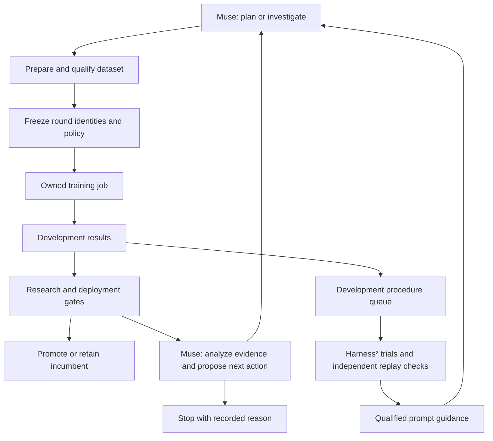

# Architecture

[Documentation index](README.md) · [Campaign integration](campaigns.md) ·
[Data pipeline](data-pipeline.md) · [Operations](operations.md)

SiliconShield connects a requirement-conditioned security model, an RTL
investigation workflow, and a persistent training system. Its controllers have
different responsibilities. The Muse coding agent plans campaign steps. The
Glimmer operator handles bounded job decisions. Harness² tests and refines
prompt guidance through replay.

## Investigation path

The application preserves RTL, requirements, and assumptions, then obtains a
SiliconShield-RTL assessment through a subprocess using the model's runtime.
The assessment includes checkpoint identity, recorded question-contract
version, and input-coverage information. Workers select the exact pinned
question bytes from the export record, so a `v1` model is never scored
through the legacy `v0` question.

Requirement-bound Verilator checks supply executable evidence. A repair
proposer receives the visible design and check outcomes, without the authored
answer. The workflow applies validated replacements to a candidate copy,
reruns requirement and regression checks, and records both outcomes. Custom
CLI inputs do not inherit a demo testbench. Without an applicable check, their
requirements remain unverified.

The application uses simulation checks. The training-data checker separately
uses Icarus and Yosys SAT for registered local contracts.

## Campaign path

`execution/campaign_supervisor.py` coordinates agent sessions, preparation,
recovery, and analysis. `execution/laya_campaign.py` owns round transitions,
identity bindings, policy evaluation, and promotion. The operator and job
runner submit and observe systemd-owned jobs independently of an agent's
connection lifetime.

A round binds its parent export, incumbent reference, dataset version, recipe,
selection policy, and reporting contract. Promotion verifies candidate export
and result identities. Transaction records let the campaign resume an
interrupted promotion or report. A failed candidate does not replace the
incumbent. The latest resumable state is distinct from the selected export.

The trainer and campaign share selection predicates and versioned ranking.
Protected development populations can enforce accuracy, false-safe, pair, and
missing-context constraints. Research promotion and deployment acceptance are
evaluated separately. Configuration changes are recorded so earlier results can
still be interpreted under the rules that produced them.

## Two controller paths

The **Muse coding-agent supervisor** asks the agent to analyze, prepare, recover,
and plan within a campaign charter. The agent can propose a new hypothesis or
request an investigation. The supervisor validates preparation before launch.

The **Glimmer operator** exposes six bounded actions: continue, leave unchanged,
stop, adjust learning rate, resume, and retry finalization. Execution tools
validate authority and intervention budgets. Its separate offline replay
interface cannot submit jobs. Glimmer adapter qualification measures actions,
evidence, arithmetic, explanations, and final-response consistency. A running
service alone does not qualify an adapter for job control.

These paths are implemented separately. Deploying one does not require or
implicitly activate the other.

## Three forms of learning

**Security-model training** updates SiliconShield-RTL, including residual
adapters and optionally encoder weights. It supports BF16 distributed training,
explicit sampling pools, and a frozen-teacher preservation loss. Development
views select a checkpoint. Calibration and final evaluation are separate. LAYA
supplies the external foundation and runtime.

**Glimmer fine-tuning** updates language-model LoRA parameters from reviewed
operator episodes or preference pairs. The base and vision weights stay frozen.
Task-based selection checks each action class and checkpoint-review cohort.
Lower token loss alone is not enough to select an adapter.

**Harness² procedure learning** changes instructions. The Muse integration
allows edits to `LongTermMEMORY.md`, checks the result through a separate
signed development replay population, and publishes qualified guidance
atomically. The supervisor consumes it at future session boundaries. It does
not replace executable policy or train model weights. The older Glimmer
Harness² adapter remains a separate integration.

See [procedure learning](muse-procedures.md) for worker deployment and
qualification, and [Glimmer](glimmer.md) for adapter training.

## Data and provenance

Dataset versions pin split bytes and sampling-pool definitions. Proposal labels
come from a fixed checker with declared `bound_cycles`/`induction_steps`, not
the generator's claimed answer. Missing-context proposals need opposing
verified completions. Acceptance records bind the lineage, canonical, and
concentration audit plus `release_class` to the exact version. English
requirements need agreed template reviews. Integrity and training acceptance
are separate checks.

Controller episode ingestion uses development evidence and rejects final-test
reports. Signed manifests bind episode membership to its split. Final
evaluation is kept separate from training and procedure retention. Repeated
development use is not an independent final benchmark.

Training implementations live under `training/`. Research orchestration reaches
them through `research_loop/adapters/`. Source snapshots, model and dataset
identities, tool receipts, and execution settings make comparisons traceable.
Actual datasets, model artifacts, experiment definitions, reports, and machine
settings remain outside the source repository.
