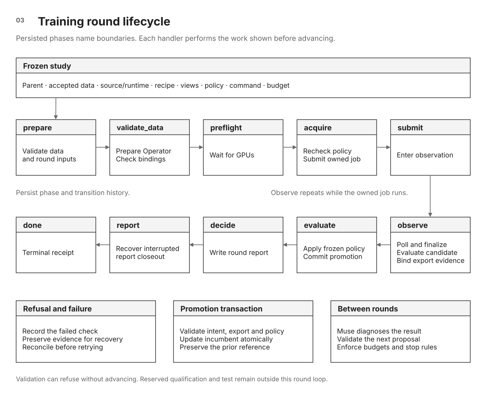

# Multi-round training campaigns

[Documentation index](README.md) · [Study walkthrough](study-walkthrough.md) ·
[Training operations and recovery](training-operations.md)

A training campaign connects completed experiments to the next research
proposal. Muse diagnoses the recorded results and proposes further work within
the authorized study. SiliconShield owns round state, GPU job execution,
evaluation bindings, and checkpoint promotion. A failed hypothesis can preserve
the incumbent and end the campaign without launching another round.

This guide covers the repeated-round integration through
`campaign_supervisor.supervise_once()` and `laya_campaign.run_round()`. It is
intended for the developer wiring the supervisor into a deployment. A bounded
Glimmer-operated job does not start this supervisor automatically, and the
coding-agent supervisor does not require a local Glimmer endpoint.

## Prerequisites and related guides

| Prepare or operate | Owning guide |
|---|---|
| Controller, model runtime, and devices | [Setup](setup.md) |
| Accepted data, frozen settings, measured receipts, and a bound job profile | [Study walkthrough](study-walkthrough.md#study-requirements) |
| One Glimmer-operated job or a fitting/development sequence | [Decision-model training with Glimmer](decision-model-training-with-glimmer.md) |
| Resource ownership, status, stop, reattachment, and recovery | [Training operations](training-operations.md) |

Begin with a verified study and an immutable source snapshot. Keep campaign
configuration, profiles, data, and receipts outside Git. Each proposed round
must satisfy its study binding. Changes to a bound recipe, dataset, policy, or
command require a reviewed amendment before submission.

## Register a campaign

A deployment calls `laya_campaign.init_campaign(root, config)` once. Required
configuration includes a campaign ID, parent export and weights hash, recipe
path and hash, selection policy, and incumbent export/results/evaluation receipt.
A reporting contract and operator profile can also be supplied. The function
verifies these inputs before writing the registry.

Register accepted dataset versions, then call `prepare_round()` with a version,
recorded hypothesis, and supported training overrides (including
`question_contract`, `review_ledger`, `review_packets`, and
`plateau_requires_full_exposure` where applicable). A repeated
identical specification is idempotent. Changing the specification under the
same round ID is refused. The round freezes the incumbent, dataset, recipe,
policy, question contract, review ledger and packets, and report bindings.
The campaign-generated round recipe includes the incumbent-derived selection
reference. The job profile must point to that recipe. This round binding is
separate from the decision-study manifest and does not replace its exact
launch binding.

Campaign configuration and dataset registration use Python APIs. Bind the
reviewed recipe in the profile itself. The owned service explicitly receives
`CUDA_VISIBLE_DEVICES`, `LAYA_ROOT`, and the registered
`SILICONSHIELD_SECURITY_RECIPE`. It does not inherit arbitrary interactive-shell
settings. Synthetic fixture evidence is not a substitute for measured baseline
and launch receipts.

## Round lifecycle

**Figure 03.** The state names match `PHASES` in `laya_campaign.py`.
[Open full-size SVG](diagrams/decision-study.svg) ·
[Editable draw.io source](diagrams/siliconshield-architecture.drawio)

A phase is a persisted boundary. Its handler performs work before advancing:

| Persisted phase | Work on the next driver pass | Successful next state |
|---|---|---|
| `prepare` | Validate the registered dataset and round inputs. | `validate_data` |
| `validate_data` | Prepare/preflight the Operator and check campaign/profile bindings. | `preflight` |
| `preflight` | Wait for GPU availability. | `acquire` |
| `acquire` | Recheck the frozen policy and submit the owned job idempotently. | `submit` |
| `submit` | Enter observation. | `observe` |
| `observe` | Reconcile the unit, finalize a completed job, invoke the evaluator, and attach the verified candidate. | `evaluate` |
| `evaluate` | Apply selection, revalidate evidence, and complete the promotion transaction. | `decide` |
| `decide` | Write and close the round report. | `report`, then `done` |
| `report` | Recover an interrupted report closeout. | `done` |

The live-job wait remains in `observe`. An unavailable resource can keep the
round in `preflight`. Any active phase may explicitly transition to `failed`.
Some validation failures raise before a transition, preserving the last phase
for diagnosis. A refused operation therefore does not necessarily produce a
terminal round receipt.

A restart rereads the receipt. It does not unconditionally submit a new job. Promotion uses a transaction intent and
revalidates the candidate export, evaluation receipt, frozen policy, and
incumbent before completing the change.

`run_round()` requires two integration functions:

- `operator_factory(profile_path)` returns an operator for the registered job
  profile, normally the existing `Operator` class.
- `evaluator(campaign_root, round_id, reported_job)` returns the candidate export,
  adapted results, and an identity-bound evaluation receipt.

The evaluator must bind real results to the correct round and export. It is not
sufficient to return a metrics dictionary with a successful process exit.
`selection_inputs_from_report()` adapts trainer views and cross-checks rates
against counts. Receipt validation checks which export produced those results.

## Wire the supervisor

`supervise_once(home, config, operator_factory=..., evaluator=...)` reconciles
unfinished rounds, records terminal results, runs at most one agent session, and
writes status. `home/campaign/` contains the registry and round state.
`home/campaign/supervisor/` contains the durable handoff.

The local driver must supply the callbacks, polling schedule, singleton/service
ownership, and deployment paths. There is no `campaign_supervisor --config`
command or generic supervisor systemd unit in this repository. Keep that
machine-specific driver outside Git and launch it against a frozen source tree.

Agent configuration names `muse_bin`, `model`, and `repo`, with optional
per-session timeouts, model-step limits, reasoning effort, extra arguments,
and `agent_env_extra` allowlist entries. Optional `procedure_queue` and
`procedure_bundle` connect the separate Harness² worker. See
[Muse procedure learning](muse-procedures.md).

The agent runs sandboxed by default with web tools disabled. Set
`allow_unsandboxed_agent: true` in the operator-owned config only for a
trusted coding-agent path with workspace access — never by default for
unattended sessions, and never as a substitute for deployment isolation.
Agent and tool subprocesses inherit only an allowlisted environment and run
under bounded CPU, memory, output, and process limits. Filesystem access
itself is unchanged, so untrusted work still belongs on an isolated host.
Deterministic campaign checks protect launch and promotion. They do not turn
the coding agent itself into a sandbox.

## Preserve incumbents and policies

Promotion and deployment acceptance are separate outputs. A candidate may
satisfy deployment thresholds but fail to improve the research incumbent, or
improve research metrics while failing deployment requirements. Compare the
recorded reasons and rank vectors to see which rules passed or failed.

`v1-transfer` retains the transfer-oriented tiebreak. `v2-retention` orders
feasible candidates by fewer retention false-safes, more correct decisions, more
correct pairs, retention NLL, and transfer NLL. Changes to ranking semantics are
policy changes. Explicit relaxation requires the update API's authorization and
a recorded reason. The supervisor does not silently loosen gates.

## Stop, park, or propose a new specialist

The supervisor checks the registered budget before another launch. A completed
round needs recorded diagnosis before its result can justify further work.
Execution defects, inadequate exposure, and label problems call for correction,
not a claim that the model has reached its capacity.

A new-specialist recommendation requires an exhausted budget, recorded
diagnosis for every terminal round, and at least one completed attempt with
full exposure, verified SDK parity, and demonstrated TRAIN fit. Only poor
generalization or a retention trade-off supports that recommendation. A
successful promotion blocks an exhausted-model claim.
It records the proposed domain, dataset plan, and evaluation plan, preserves
the incumbent, and parks for owner authorization. It does not start a new study.

Keep the terminal or parked reason with the campaign handoff. Follow
[training operations](training-operations.md) before resuming, and reconcile any existing owned
job before submitting another one.
