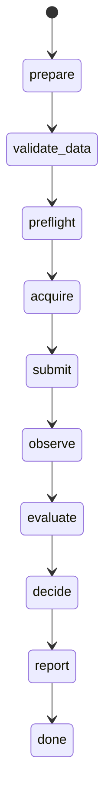

# Campaigns and controllers

[Documentation index](README.md)

SiliconShield separates experiment planning, job execution, and checkpoint
promotion. An agent recommends changes. The job runner records what executed,
and the campaign applies the checkpoint acceptance rules.

## Choose a controller

| Path | Scope | Entry point |
|---|---|---|
| Muse coding-agent supervisor | Analyze completed rounds, prepare a proposal, recover, investigate, or plan the next round. | `campaign_supervisor.supervise_once()` Python API. |
| Bounded Glimmer operator | Operate one preauthorized experiment within an intervention budget. | `python -m siliconshield.research_loop.execution.glimmer_operator --config ...` |
| Glimmer training watcher | Follow a training container with evaluation and optional Harness² work. | `python -m siliconshield.research_loop.execution.campaign --help` |
| Fitting/development strategy | Sequence configured fitting and development arms. | `python -m siliconshield.research_loop.execution.strategy --config ...` |

These are separate paths. The campaign supervisor does not require a locally
served Glimmer adapter. The Glimmer operator does not create an unrestricted
follow-on research campaign.

## Register a campaign

A deployment calls `laya_campaign.init_campaign(root, config)` once. Required
configuration includes a campaign ID, parent export and weights hash, recipe
path and hash, selection policy, and incumbent export/results/evaluation receipt.
A reporting contract and operator profile can also be supplied. The function
verifies these inputs before writing the registry.

Register accepted dataset versions, then call `prepare_round()` with a version,
recorded hypothesis, and supported training overrides (including
`question_contract`, `review_ledger`, `review_packets`, and
`plateau_requires_full_exposure` where applicable). A repeated
identical specification is idempotent. Changing the specification under the
same round ID is refused. The round freezes the incumbent, dataset, recipe,
policy, question contract, review ledger and packets, and report bindings.
A fresh single-view study freezes an exact-id selection view with no
retention population. Its generated
recipe contains the incumbent-derived selection reference and must be the
recipe used by the training profile.

Campaign configuration and dataset registration use Python APIs. The regression fixtures in
[test_laya_campaign.py](../tests/test_laya_campaign.py) show the complete contract
using synthetic artifacts. Do not substitute dummy evidence to initialize a real
campaign.

## Round lifecycle



A failed phase can terminate in `failed`. Waiting for a running job returns the
persisted state for a later pass. A restart rereads the receipt. It does not
unconditionally submit a new job. Promotion uses a transaction intent and
revalidates the candidate export, evaluation receipt, frozen policy, and
incumbent before completing the change.

`run_round()` requires two integration functions:

- `operator_factory(profile_path)` returns an operator for the registered job
  profile, normally the existing `Operator` class.
- `evaluator(campaign_root, round_id, reported_job)` returns the candidate export,
  adapted results, and an identity-bound evaluation receipt.

The evaluator must bind real results to the correct round and export. It is not
sufficient to return a metrics dictionary with a successful process exit.
`selection_inputs_from_report()` adapts trainer views and cross-checks rates
against counts. Receipt validation checks which export produced those results.

## Wire the supervisor

`supervise_once(home, config, operator_factory=..., evaluator=...)` reconciles
unfinished rounds, records terminal results, runs at most one agent session, and
writes status. `home/campaign/` contains the registry and round state.
`home/campaign/supervisor/` contains the durable handoff.

The local driver must supply the callbacks, polling schedule, singleton/service
ownership, and deployment paths. There is no `campaign_supervisor --config`
command or generic supervisor systemd unit in this repository. Keep that
machine-specific driver outside Git and launch it against a frozen source tree.

Agent configuration names `muse_bin`, `model`, and `repo`, with optional
per-session timeouts, model-step limits, reasoning effort, extra arguments,
and `agent_env_extra` allowlist entries. Optional `procedure_queue` and
`procedure_bundle` connect the separate Harness² worker. See
[Muse procedure learning](muse-procedures.md).

The agent runs sandboxed by default with web tools disabled. Set
`allow_unsandboxed_agent: true` in the operator-owned config only for a
trusted coding-agent path with workspace access — never by default for
unattended sessions, and never as a substitute for deployment isolation.
Agent and tool subprocesses inherit only an allowlisted environment and run
under bounded CPU, memory, output, and process limits; filesystem access
itself is unchanged, so untrusted work still belongs on an isolated host.
Deterministic campaign checks protect launch and promotion. They do not turn
the coding agent itself into a sandbox.

## Operate one job with Glimmer

Copy [the operator example](../configs/glimmer-operator.example.json) outside
Git and configure a verified endpoint/adapter, profile, experiment ID, output,
polling budget, and intervention limits. Then use:

```bash
python -m siliconshield.research_loop.execution.glimmer_operator \
  --config /path/to/operator.local.json
```

The six actions are `continue`, `leave_unchanged`, `stop`, `adjust_lr`,
`resume`, and `finalize_retry`. The execution state machine validates authority,
parameters, resume identity, and budget before acting. Inspect the returned
execution state to confirm whether an intervention ran.

Reaching the polling limit does not mean the training job has stopped. The
systemd-owned job can outlive the client. Reconnect to its recorded identity. Do
not resubmit it under a new experiment ID to obtain status.

## Preserve incumbents and policies

Promotion and deployment acceptance are separate outputs. A candidate may
satisfy deployment thresholds but fail to improve the research incumbent, or
improve research metrics while failing deployment requirements. Compare the
recorded reasons and rank vectors to see which rules passed or failed.

`v1-transfer` retains the transfer-oriented tiebreak. `v2-retention` orders
feasible candidates by fewer retention false-safes, more correct decisions, more
correct pairs, retention NLL, and transfer NLL. Changes to ranking semantics are
policy changes. Explicit relaxation requires the update API's authorization and
a recorded reason. The supervisor does not silently loosen gates.

Stopping after failed hypotheses is a supported outcome. See
[operations](operations.md) before resuming a stopped or parked campaign.
