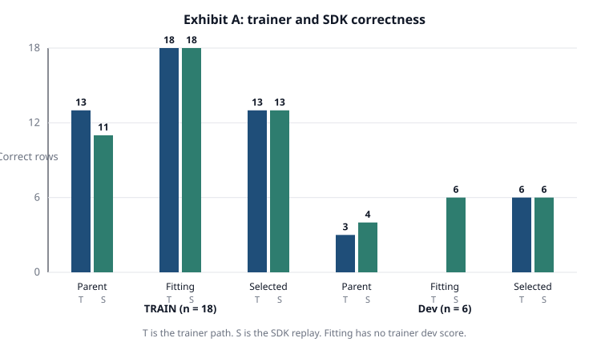
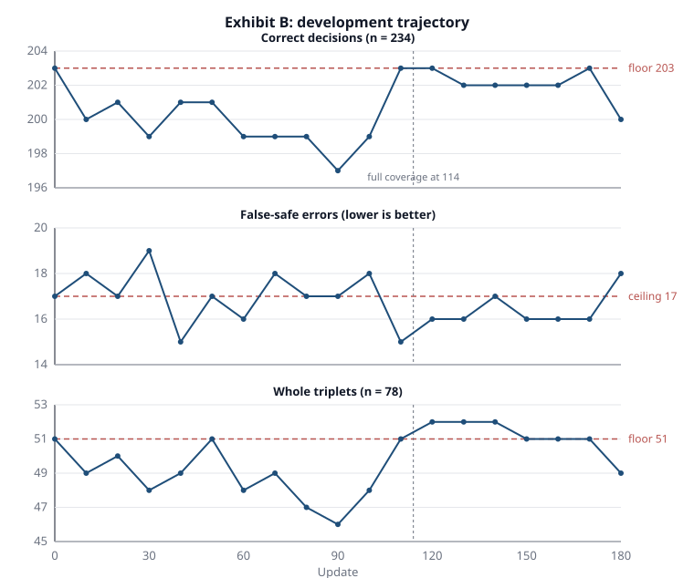
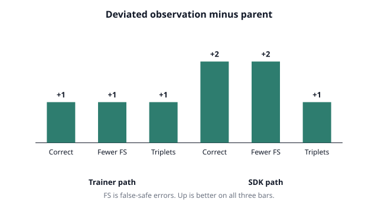

# Retained-model training under a local Muse Glimmer operator

## Case study: two Glimmer-operated training runs on local hardware

Scientific case study | 2 November 2026

[Documentation index](README.md)

> Scope: this case study records Glimmer-operated training runs for the
> retained local research path. That path is disabled by default and is not
> part of the shipped product, which uses Glimmer and the Contract skills.

### Abstract

This report asks whether a locally served Muse Glimmer
model can operate a complete retained-model training loop with no
cloud dependency and no human turn inside the loop. Two exhibits
answer two halves of the question. Exhibit A runs the smallest
complete loop: 24 authored decisions (18 TRAIN rows and 6 development rows),
one workstation GPU,
nine fitting updates plus nine development updates, frozen
selection, and independent reload verification. The loop completed
and every artifact verified. Exhibit B runs the same operator at
real scale: a 300-update improvement round for the released
temporal specialist on its registered development population.
The round reached a terminal plateau at update 180 with no
qualifying checkpoint, the selector preserved the parent, and
the null result is reported with per-eval class evidence. The
study establishes local operability of the training loop under
Glimmer, including failure containment and receipt discipline.
It does not establish model quality, which is covered by the
[research white paper](whitepaper.md) and
[capabilities and limitations](LIMITATIONS.md).

### 1 Research question

SiliconShield trains small retained models that check RTL against
security requirements. Training runs are long, GPU-backed, and
stateful, so they are managed by a bounded operator loop: submit
an owned job, observe its receipts, invite bounded model
interventions, and finalize on completion. The operator was
designed so that a model proposes actions but the state machine
owns safety. This study tests that design with the base Glimmer model, served from
local weights, with no task-specific tuning for operations.

The question has two parts. First, can the base model drive the
full loop without breaking it: submission, observation turns,
completion, selection, and verification. Second, does the loop
stay honest at real scale: frozen objectives, floor enforcement,
and a null verdict when no checkpoint qualifies.

### 2 Common apparatus

All compute stayed on local hardware. Training ran on one NVIDIA
RTX PRO 4000 in the workstation. Glimmer served from local
weights on an on-premises DGX Spark box, reached over local SSH.
Orchestration ran on the workstation. No cloud service took part
in training, serving, or decisions.

The software path is the repository training flow described in
[Training](security-model-training.md). A campaign driver submits one
fitting arm, promotes the recipe by measured TRAIN gain, then
runs one development round. The operator prepares, preflights,
submits, observes, and finalizes owned systemd jobs. Preflight
refuses to disturb live GPU work, probes the worker entrypoint
import from the frozen source snapshot, and checks that free
disk covers twice the parent export size. Every phase writes
hash-bound receipts. The model acts only through allowlisted
operator tools, and terminal completion never requires a model
action.

Data discipline held for both exhibits. Sealed evaluation
populations stayed sealed. Benchmark rows were not used as optimization examples. The registered
Contract-2 development view overlaps the public benchmark and was reused
for selection. It is not independent evaluation. Reserved populations were
not opened.

### 3 Exhibit A: the complete toy loop

Exhibit A asks whether the loop runs end to end under Glimmer
with every artifact verifiable. The data was 24 hand-written
rows forming 8 complete decision triplets: 18 TRAIN rows across
6 mechanisms and 6 development rows across 2 fresh mechanisms,
with disjoint split groups. No row was copied from the existing training or evaluation collections. The parent was the released local-guard
export, used read-only. Training continued its adapters and
decision head with the encoder frozen, one GPU, batches of 6
rows, 9 fitting updates plus 9 development updates, seed 7.

#### 3.1 Fitting and development

The fitting arm moved TRAIN accuracy from 13/18 to 18/18 with
NLL 0.04 and promoted the recipe on positive gain. The
development round scored 6/6 with every class recall at 1.0,
zero false-safe errors, whole triplets 2/2, and NLL 0.24. The
default acceptance gate passed and step 3 was selected. The
campaign record closed as complete with sealed evaluation
untouched. These numbers validate the loop, not the model.
Twenty-four toy rows cannot support any quality claim.

#### 3.2 Operator behavior

The base model recorded well-formed turns throughout: run
inspection, resource inspection, a decision, and a final text
matching the recorded action. On the healthy runs it chose
leave-unchanged and continue with accurate reasons. One turn
was correctly superseded when its job completed mid-inference.
One development cycle hit a transient SSH transport failure.
The loop recorded the error, the owned job kept running, and
the next cycle continued. Completion needed no model action.

Two earlier assembly failures exercised the guards. A snapshot
holding only the trainer failed on worker import, and a study
missing declared source mass failed in reporting weights.
Glimmer proposed stop on both dead runs. Both proposals were
rejected, one for lack of recorded failure evidence and one
for lack of a running job. The model was semantically right
and the guards were conservative. Those two failures motivated
the pre-submit validator, the preflight entrypoint probe, and
the abandon path now in the repository.

#### 3.3 Independent verification

Both toy exports were reloaded through the production SDK on
CPU and scored on all 24 rows. The fitting export reproduced
the trainer TRAIN predictions 18/18 and the development
export reproduced the trainer development predictions 6/6.
Exact reload parity establishes both exports as coherent
artifacts.

The same replay exposed a genuine eval-path gap on the
parent: SDK scoring matched the trainer on only 14/18 TRAIN
rows and 5/6 development rows, with confident disagreement
on missing-context rows. Single-row reruns reproduced the
flips, which rules out batching. Precision and
input-preparation differences remain as candidates and are
not isolated here. The lesson is that reload parity is only
meaningful with pinned inference settings, and the pin must
cover more than batch size.

A sibling comparison under identical SDK settings showed
selection working visibly: both children fixed the parent
confident errors, while the development-selected checkpoint
scored TRAIN 13/18 against its sibling 18/18, including one
TRAIN false-safe its sibling avoids. Development-optimal is
not TRAIN-optimal, row by row.

**Figure 1.** Exhibit A eval parity. Both children reproduce
exactly across paths. The parent disagrees with itself, so
reload parity needs pinned inference settings. Counts come
from the preserved SDK replay and trainer events.
[Open full-size SVG](diagrams/glimmer-toy-parity.svg)

### 4 Exhibit B: a real-scale improvement round

Exhibit B asks whether the loop stays honest at real scale.
The study targeted documented Contract-2 weaknesses from
[capabilities and limitations](LIMITATIONS.md): 203/234
correct with 17 false-safe errors and 51/78 whole triplets,
context solved, satisfies and violates confused, worst in
commit and hold, arbiter-tree, empty-data-blanking, and
stored-word-hold families. The intervention was one variable:
weak-family emphasis pools (900 weak rows against 1791 base
rows at equal mass) under plain continuation with the
encoder frozen. The historical worst-member triplet objective was not part of this
recipe. It is distinct from the trainer's pair-loss options. The frozen plan pinned parent,
data, pools, recipe, views, seed 9001, and a 300-update
budget with triplet-first selection floors set to the
parent counts. Full triplet coverage landed at update 114.

#### 4.1 Trajectory and terminal verdict

The fitting arm passed with TRAIN gain plus 0.001. An
identical fitting configuration under the previous campaign
prefix had gained plus 0.008, so small fitting gains vary
run to run at fixed seed and only the sign was used. The
development round stopped by plateau at update 180 past the
150-update minimum. Early scores fluctuated around the baseline,
recovered to 203 correct with 15 false-safe errors at
update 110 and 52 triplets at update 120, then drifted.
No trained checkpoint passed all floors jointly. The
closest evals cut satisfies recall to 62 or 63 against the
floor of 64 while reducing false-safe errors. Every
aggregate gain in the run traded one protected count for
another. The selector kept the parent weights and the
study closed as a null result with the parent preserved.

**Figure 2.** Exhibit B trajectory. Dashed red lines mark the
frozen parent floors. The run recovers to the correct-count floor near update 110.
The additional satisfies-class panel explains why apparent aggregate gains
still fail selection. No trained evaluation passes all floors jointly, so
the selector keeps the parent. The dotted
line marks full triplet coverage at update 114.
[Open full-size SVG](diagrams/glimmer-improvement-trajectory.svg)

A deviated observation from a misconfigured 30-update
attempt deserves exact reporting. Its selected step-20
weights beat the parent on every count under both eval
paths: trainer 204 correct with 16 false-safe errors and
52 triplets against 203 with 17 and 51, SDK 203 with 18
and 51 against 201 with 20 and 50. The observation is real
but not promotable because its schedule differs from the
frozen recipe. It is preserved as the hypothesis for a
follow-up short-horizon round under a newly frozen plan.

**Figure 3.** The deviated observation beats the parent on
every count under both eval paths. It is exploratory evidence because its schedule differs from the frozen
recipe. It does not qualify the checkpoint for promotion.
[Open full-size SVG](diagrams/glimmer-deviated-deltas.svg)

#### 4.2 Operator behavior at scale

Glimmer operated 180 updates and 18 tracked development
evaluations to the terminal boundary without human turns. The campaign
record is complete and the receipts bind parent, data,
recipe, views, seed, and selection. Two pre-launch config
errors (a schedule inconsistency and a views file passed to
a fitting arm) were both diagnosed from one-line failure
receipts without opening logs. No sealed data was touched
and no gate was relaxed after seeing results.

### 5 Analysis

The two exhibits jointly establish that the training loop
is locally operable under a Muse Glimmer operator.
Exhibit A exercised submission, observation, selection, reload
verification, and closeout. Exhibit B exercised frozen selection constraints
over 180 updates and preserved the parent when no candidate qualified.
Together they demonstrate these execution paths under the tested conditions.
They do not establish reliable autonomous judgment across all operator actions.

Three findings qualify the claim. First, the base model
was only exercised on conservative actions: continue,
leave-unchanged, and stop on dead runs. Harder judgments
such as learning-rate intervention on ambiguous evidence
were never needed and remain untested. Second, the
SDK-versus-trainer eval gap means verification must pin
the full inference path. Directional agreement across
paths carried this study, but parity claims need tighter
controls. Third, the toy loop demonstrates operability under its tested conditions.
Its 24 rows say nothing about whether continued training
improves any real capability.

### 6 Limitations and non-claims

This study makes no model-quality claim for either run.
The toy exports are loop-validation artifacts and are not
releasable. The improvement round produced no qualifying
checkpoint and the parent stands unchanged. The deviated step-20 measurement is a real exploratory result,
not a qualifying improvement under the registered protocol. It motivates a
prospective short-horizon hypothesis. The
development populations here were repeatedly used and
cannot support independence claims. The public benchmark remains development evidence. A future generalization
claim needs a separately reserved, group-disjoint evaluation population.

### 7 Reproducibility

The toy study record preserves the dataset generator,
dataset, pools, recipe, profile, campaign config,
validator receipt, campaign record with operator traces,
run receipts, and the SDK parity script with its outputs.
The improvement study preserves the frozen plan, pools,
recipe, views, profile, campaign config, validator
receipt, run receipts with per-eval snapshots, the SDK
verification script, and the written verdict. Both records
live outside Git with the research artifacts. Model
weights from the toy runs were pruned after verification
to reclaim disk, with all predictions and receipts kept.
CPU validation and owned GPU launch procedures are maintained
with the training procedures. Configuration and
closeout instructions distinguish input validation from job submission.

### 8 Conclusion

A locally served Muse Glimmer model operated a complete
retained-model training loop on local hardware twice: once to a fully
verified toy closeout and once to an honestly reported
null result at real scale with a preserved deviated
observation. The loop contributed the safety: frozen
plans, floor enforcement, receipt-bound evidence, and
containment of model and transport failures. The
experiment supports using Glimmer as the operator for
future training studies with the same discipline, and
it sets the bar for the next claim: a jointly qualifying
checkpoint under a frozen recipe.
