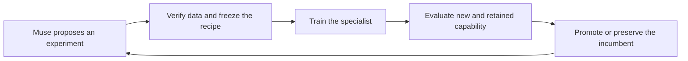

# Demo: from an unauthorized write to a checked repair

[Documentation index](README.md) · [Project brief](project.md) ·
[Full investigation guide](investigation.md)

The demo answers one question: **can an engineer inspect a concrete
security violation, a proposed repair, and evidence that the repair
preserves legitimate behavior?** Present the reproducible authored path
first, then the live Muse path when a qualified endpoint is available.
Use the final part to explain how training is controlled.

## Choose and label the mode

| Mode | Requirements | What it demonstrates |
|---|---|---|
| Authored workflow | Python package, Verilator, C++ build toolchain | Executable detection and re-verification with an authored patch. |
| Live Muse repair | The above plus a qualified chat endpoint and model identity | A model-proposed patch checked by the same executable tests. |
| Specialist-assisted live repair | The above plus a qualified SiliconShield-RTL export and worker environment | Real model assessment, Muse proposal, and tool evidence in one report. |

The authored workflow is reproducible without model weights. It is useful for
installation and fallback demonstration, but it is not evidence of Meta model
behavior. A strong submission should show the live path and name its models.
An unavailable specialist must remain marked unavailable, not replaced by an
expected label. If it predicts incorrectly, show the disagreement and how the
executable evidence affects the conclusion.

## Prepare before presenting

Follow [setup](setup.md) and use a new output directory. Check that the authored
example compiles. For a live session, qualify the exact endpoint, adapter,
parser, and checkpoint first. Load the model before the presentation so startup
does not delay the investigation.

Keep original inputs and testbenches fixed during the demonstration. Do not
change checks after seeing a generated patch to make it pass. Model responses
can vary: if a patch fails, retain that result. A recorded successful live run
may be shown if it is labeled as a recording and identifies the model and
inputs.

## A four-minute presentation

Times are a suggested presentation budget, not measured runtime or event rules.
Compilation and model generation may require a recorded segment with cuts labeled.

| Time | Show | Explain |
|---|---|---|
| 0:00–0:30 | The requirement and write condition | A register that accepts writes can still violate access policy. |
| 0:30–1:00 | Original requirement check and counterexample | An unprivileged write changes protected state. |
| 1:00–2:00 | The model assessment and Muse-proposed diff | Keep the specialist's assessment separate from the executed evidence and agent proposal. |
| 2:00–2:45 | Candidate requirement and regression results | Unauthorized writes must be blocked while authorized writes still work. |
| 2:45–3:15 | Evidence report | Show the input, checkpoint, patch proposer, commands, and conclusion together. |
| 3:15–4:00 | One reviewed training-round decision | Explain how the system can improve the specialist without silently replacing it with a regressed checkpoint. |

If campaign results are not ready to share, use the final segment to explain the
architecture.

## Act one: access control

The authored case in [demo_cases.py](../siliconshield/app/demo_cases.py) contains
this write condition:

```systemverilog
else if (wr_en) cfg_reg <= wdata;
```

Its requirement says that an unprivileged write must leave `cfg_reg` unchanged.
The example's reference repair adds the privilege check:

```systemverilog
else if (wr_en && privileged) cfg_reg <= wdata;
```

These excerpts explain the case. The complete module, reset assumptions, and
testbenches are in the source. Do not provide the reference repair to the live
proposer. The workflow's proposer context excludes it.

Run the authored workflow:

```bash
python -m siliconshield.app --case unauthorized-write \
  --output /tmp/siliconshield-authored-demo
```

Or, with a separately configured live service, request a Muse patch:

```bash
python -m siliconshield.app --case unauthorized-write \
  --muse-endpoint http://127.0.0.1:18320/v1/chat/completions \
  --muse-model YOUR_QUALIFIED_REPAIR_MODEL \
  --output /tmp/siliconshield-live-demo
```

The example endpoint is a placeholder local service address. Use a model
qualified for repair proposals. Do not assume an adapter trained only for
checkpoint triage has RTL-repair competence.

Configure `SILICONSHIELD_SECURITY_PYTHON`,
`SILICONSHIELD_SECURITY_CHECKPOINT`, and the compatible runtime to include a
real specialist assessment. See [investigation](investigation.md#connect-a-trained-security-model).

## Show the evidence, not just the status

Open `report.md`, then use `report.json` for the exact fields:

| Evidence | Report location |
|---|---|
| Requirement, assumptions, and preserved RTL | `inputs` |
| Specialist label, identity, and coverage status | `security_assessment` |
| Original counterexample | `checks.original` and linked build/simulation logs |
| Whether Muse or the authored case supplied the patch | `patch.proposer` |
| Exact candidate changes | `patch.diff` |
| Candidate requirement and regression outcomes | `checks.patched` |
| Overall conclusion and repair acceptance | `conclusion` |

A successful repair should end with `demonstrated_violation_fixed` and
`repair_accepted: true`. That means the supplied checks passed on this case. It
is not proof that every vulnerability has been removed. Do not suppress
`patch_error`, incomplete checks, a failed regression, or model disagreement.

## Act two: explain how training is controlled

Use this diagram to introduce the training loop:



For a real round, show its hypothesis, immutable parent and data identities,
selected checkpoint, per-view results, and promotion reason. A rejected round
can be a useful demonstration: the system kept the incumbent because a candidate
broke a registered constraint. Do not invent a rejection or cherry-pick a score
without its other gates.

## Submission evidence still to qualify

| Claim | Evidence needed before using it |
|---|---|
| Muse repaired the design | A real proposal labeled with its model identity and unchanged checks passing afterward. |
| The specialist adds value | A matched comparison separating specialist contribution from the verification/agent path. |
| Training improved the specialist | Parent/candidate results with population, artifact, and inference identities, plus retained-capability checks. |
| Glimmer became a better operator | Matched replay with per-action and explanation/final-consistency results. |
| Engineers work faster | A measured task-time/reviewer-effort comparison, not inference speed alone. |
| The system generalizes | A frozen protocol on appropriate unseen designs, with scope and uncertainty. |

Keep raw runs, transcripts, machine details, and experiment datasets outside Git.
Any result table, recording, or screenshot proposed for publication needs its own
privacy and evidence review. The source documentation intentionally contains no
private benchmark numbers.
