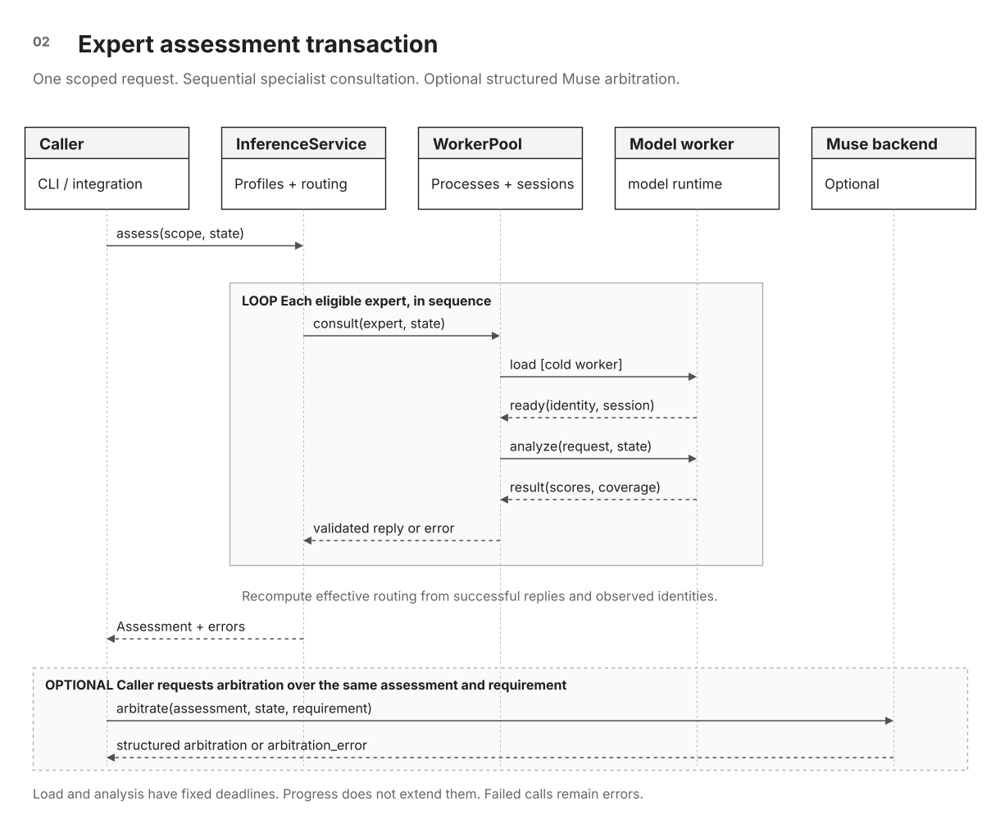

# Router architecture

[Documentation index](README.md) · [Decision-model qualification](expert-qualification.md) ·
[Benchmark](benchmark.md)

The router connects an explicit assessment scope to specialists with relevant
measured capabilities. It preserves each model's result, ranks the available evidence,
and makes coverage gaps explicit before optional Muse arbitration. No single
model covers the whole design space. Scope tags identify the property class,
and measured profiles determine which specialist evidence is available. The
Contract-1 decision model handles local guard requirements. The Contract-2
decision model handles FIFO, counter, and arbitration requirements. Anything outside measured
support stays visible instead of receiving an unqualified verdict. This is application-level expert routing,
not a jointly trained neural mixture of experts. Improvement over the best
single model requires a matched evaluation.

## Assessment transaction



**Figure 02.** Request/reply sequence for the experts CLI/API. Solid arrows are
calls and dashed arrows are replies. The loop consults experts sequentially.
[Open full-size SVG](diagrams/expert-assessment.svg) ·
[Editable draw.io source](diagrams/siliconshield-architecture.drawio)

The experts CLI and Python API expose this path. Modules live in
`siliconshield/experts/`, with evaluation in
`siliconshield/benchmark/`. The two current decision models are
[Contract-1](https://huggingface.co/debjyotikm/siliconshield-rtl-contract-1)
(local guards) and
[Contract-2](https://huggingface.co/debjyotikm/siliconshield-rtl-contract-2)
(FIFO, counter, and arbitration specialist), routed by tiers measured on the
[public RTL benchmark](https://huggingface.co/datasets/debjyotikm/siliconshield-rtl-benchmark).

## Run one assessment

For worked English-to-RTL examples, see
[Writing requirements for RTL analysis](rtl-requirements.md).
Prepare the input as a small verification problem:

1. Name the protected state and one required behavior. Distinguish a request
   from an accepted operation, particularly for FIFO and handshake logic.
2. Include every relevant writer, guard, helper definition, signal width, and
   priority branch. Preserve the source locations of extracted RTL.
3. State the reset scope and any environment constraints that affect the answer.
4. Choose mechanism tags supported by the registered capability profiles.

First register immutable exports and measured capability profiles as described
in [decision-model qualification](expert-qualification.md). A registry without
capability profiles provides no routable experts.

The state file uses literal section headers, without colons:

```text
REQUIREMENT
After reset, a push while full must leave occupancy unchanged.

ASSUMPTIONS
Two-state logic sampled at the rising clock edge. Reset is exempt.

RTL
module topmodule(input logic clk, rst_n, push, full,
                 output logic [3:0] occupancy);
  always_ff @(posedge clk) begin
    if (!rst_n) occupancy <= 4'd0;
    else if (push && !full) occupancy <= occupancy + 1'b1;
  end
endmodule
```

Here `full` is an environment-supplied signal. The property checks hold behavior
when that signal is asserted. It does not check how `full` is generated, the
queue depth, or stored-data ordering. This is an authored format example, not a
measured model prediction. Save it outside Git and run:

```bash
python -m siliconshield.experts assess \
  --registry /path/to/models.local.json \
  --scope fifo --state-file /path/to/assessment.txt
```

For arbitration, add `--arbitrate` and pass `--requirement` equal to the full
requirement in that file. Muse uses the configured local CLI and existing login.
Adding `--issue`, `--relevance`, and repeatable `--rtl` locations requests a
traceable finding as well. For example:

```bash
python -m siliconshield.experts assess \
  --registry /path/to/models.local.json \
  --scope fifo --state-file /path/to/assessment.txt \
  --arbitrate \
  --requirement "After reset, a push while full must leave occupancy unchanged." \
  --issue "Occupancy update during backpressure" \
  --relevance "A count change could invalidate the full condition." \
  --rtl "topmodule:occupancy update"
```

The JSON contains `assessment`, and optionally `arbitration` and `finding`.
Inspect `assessment.errors`, effective `routing`, and `thin_evidence` before
using it. An `arbitration_error` preserves the expert assessment but supplies no
Muse verdict. A zero CLI exit alone is not a successful assessment.

### Reading a real assessment

A recorded rehearsal of the FIFO example above produced these outcomes under
one matched worker protocol. These are integration observations on an authored
case, not a fresh benchmark or promised output on every runtime:

| Evidence | Recorded result | Interpretation |
|---|---|---|
| Contract-2 | `satisfies_requirement`, score 0.9061 | Agrees with the visible `push && !full` guard |
| Contract-1 | `violates_requirement`, score 1.0000 | Incorrect on this case despite the higher score |
| Matched FIFO development measurements | Contract-2: 88/99 correct, 7/33 false-safes. Contract-1: 34/99 correct, 0/33 false-safes | Relevant scope support differs. Zero false-safes alone is not competence |
| Muse arbitration | `satisfies_requirement` | Cites the guard and the specialists' differing FIFO support |

The 88/99 Contract-2 figure reconciles with the original 97/108 population:
all 9 excluded rows were correct there. The C1 34/99 figure reproduces only by
running the pinned benchmark, since C1 publishes no results file.

The response used `assessment.responses` for individual votes,
`assessment.routing.area_tiers` for domain support, and `arbitration.evidence`
for cited experts. No solver ran in this assessment. Arbitration resolved this
particular disagreement, which does not establish an aggregate router advantage.

A compact view of the returned fields is shown below. Ellipses indicate omitted
fields, so this is an annotated excerpt rather than a complete response schema:

```text
assessment.errors = []
assessment.routing.unsupported = []
assessment.routing.area_tiers.contract-2.fifo = "partial"
assessment.routing.area_tiers.contract-1.fifo = "none"
arbitration.conclusion = "satisfies_requirement"
arbitration.evidence = [references to contract-2 and contract-1]
```

| Response condition | Application behavior |
|---|---|
| No routable profile or unsupported scope | Show the coverage gap and request another qualified expert or engineering review |
| One worker fails | Display its execution error and use only the recomputed effective coverage of surviving responses |
| `arbitration_error` is present | Preserve specialist evidence and report that no Muse conclusion was produced |
| Valid expert disagreement | Show both votes and the arbitration rationale. Do not turn the highest score into a vote weight |

Workers live for this command's duration. A persistent Python application can
reuse `InferenceService` and `WorkerPool` across calls. This is a local-pipe
service API, not a bundled HTTP endpoint. Muse-assisted paths may transmit
RTL and evidence to the configured provider.

## Driving assessments from Glimmer

Glimmer can drive the same assessment path through two tools,
`router.roster` and `router.assess`, with the registry bound by the
operator. The [router skill](../.agents/skills/glimmer-router/SKILL.md)
is the system prompt. It covers scope discipline, evidence reading,
and the verdict format. Run one session with:

```bash
python -m siliconshield.research_loop.procedures.glimmer_router \
  --registry /path/to/models.local.json \
  --endpoint http://127.0.0.1:18320/v1/chat/completions \
  --model glimmer-base \
  --task-file /path/to/task.txt --output /path/to/session
```

The session records messages, tool results, and the state files submitted for
assessment. Specialist predictions come from the validated router tool. Glimmer
chooses the tool arguments and writes a final conversational response. The
session accepts that response only after at least one successful
`router.assess` result with expert responses, and only when the verdict
names every consulted expert id and label; anything else aborts with an
error instead of returning a verdict. The bridge does not pass the
response through the experts CLI arbitration validator. Review the
trace to confirm that the assessed RTL and requirement match the task
and that the summary follows the tool evidence. See
[Glimmer inference](inference.md) for serving, the demonstrated
deployment and its measured throughput, and model naming.

Demonstrated on three base-model sessions against local experts.
Broader driver reliability is not established. Session verdicts
inherit the experts' documented domain limits.

### Served model identity

The demonstrated sessions used served model `glimmer-base`, the
`muse-glimmer-30b` open weights at revision
`cec94fcfd6512f2cfe708138c32533b346ea4f69`
([meta-models/Muse-Glimmer-30B](https://huggingface.co/meta-models/Muse-Glimmer-30B)).
The serving snapshot hashes to fingerprint
`ed711c3e8bafc658bfe15eb59222f1ab31c7c2422c706533345079b827e1f146`
(SHA-256 over the config, tokenizer, index, and both weight shards,
per `training/glimmer/identity.py`). A binding receipt over the
weights manifest, the server model roster, and the session traces
hashes to
`cf97f50f379bb8efda9833506aec300adafad2070c516abb0637bbadc294a7ec`.

## Routing flow

1. **Scope.** The caller names mechanism tags (for example `fifo`).
   `inspection.py` can assist the caller with lexical evidence, but the CLI
   and service do not infer scope from it. Use only tags represented by the
   capability profiles. Unratable tags stay visible instead of being dropped.
2. **Profile gate.** An expert is eligible only when its capability
   profile claims every tag; claiming a benchmark area also claims
   that area's mechanism tags. Unclaimed scopes route nowhere and are
   reported unsupported. Experts covering only some tags are
   reported as partial coverage for scope splitting, never
   consulted.
3. **Tier rank.** Eligible experts sort by worst area tier
   (strong, partial, weak, none, unrated), profile order breaking
   ties. Tiers come from the profile’s `routing_evidence` counts and full
   execution identity. The historical table in `routing_data` is
   not current authority. Changed weights, questions, runtime or
   inference settings produce an unrated result until remeasured.
4. **Thin flag.** The decision is thin-evidence when any tag is
   unsupported or unratable, nothing covers the scope, or the best
   consulted worst-tier is weak or worse. Rationale lines quote
   per-area tiers as evidence.
5. **Consult.** The shared service sends the same state to every
   routed expert over persistent worker subprocesses. Replies are
   validated through the result protocol. Transport and validation
   failures return as errors, never as labels. Models load on demand
   after routing, so an unrelated broken expert cannot block the scope.
   Stored profiles that fail to load or bind are likewise excluded
   from routing and disclosed as broken, never silently dropped.
   The returned `routing` is recomputed from successful replies.
   `planned_routing` preserves the original consultation plan.
6. **Arbitrate.** Muse weighs expert suitability, RTL evidence, and
   disagreements into one verdict with open questions. Votes and
   raw confidence never decide alone. Exact state, request, scope,
   full requirement and assumptions must match the expert evidence.
   Incompatible question contracts are refused. A failed expert cannot
   supply evidence strength to the surviving responses.
7. **Finding.** The verdict binds to the issue, requirement, RTL
   locations, consulted experts, and unresolved questions, always
   labeled a model assessment.

## Transaction invariants

| Invariant | Enforcement | Observable outcome |
|---|---|---|
| One input per consultation | The same state text is sent to all routed experts. Replies bind its SHA-256 and the active worker request. | A foreign or stale reply is rejected. |
| Full scope coverage | A profile must claim every scope tag to be consulted. A union of partial profiles is not treated as one qualified expert. | Partial and unsupported coverage are returned separately. |
| Evidence follows execution | Runtime identity must match the profile's measured execution identity for its area tier to apply. | Changed execution is unrated until measured. |
| Failures remain visible | Transport and validation errors are separate from successful model responses. | No error is converted to `insufficient_context`. |
| Coverage is recomputed | Effective routing uses only successful replies and their observed identities. | A failed expert cannot make remaining evidence appear stronger. |
| Arbitration is bound | State, complete requirement, assumptions, request, and scope must agree with the assessment. | Incompatible arbitration refuses while the original assessment remains available. |

The [wire reference](reference.md#decision-and-worker-contracts) specifies the
score tolerance, coverage fields, identity fields, and deadlines.

## Reliability tiers

Tiers derive from benchmark accuracy per (model, area): strong at
or above 80%, partial at 60%, weak at 40%, and none below 40%, with a
one-tier demotion when false-safes exceed 15% of violations. The
profile records correct, total, violation, false-safe and error counts
plus benchmark bytes and the observed execution identity. Areas with
execution errors are unrated. Historical measurements alone do not
establish that the current runtime has the same behavior.
Re-measure from benchmark reports when data or checkpoints change.
Never edit tiers by hand.

## Provisioning future models

Use [decision-model qualification](expert-qualification.md) to register an immutable
export, measure its capability profile, qualify routing, and retain a rollback
release. That guide also covers upgrades and removal. A different output task
or worker protocol needs an explicit integration change.

## Verification

- Unit: `tests/test_multi_expert.py` (routing, envelopes, service,
  arbitration) and `tests/test_benchmark.py` (metrics, runner,
  router sampling) run CPU-only with synthetic fixtures.
- Live: `benchmark run` and `benchmark router-eval` exercise real
  checkpoints through real workers. The fifo/counter slice is the
  fast integration smoke check for both contracts.
- Gates: ruff, format, compile, mypy, and pylint per the Python
  style guide before any change lands.

## Runtime evidence contract

The [interface reference](reference.md#decision-and-worker-contracts) owns the
required ready/result fields, coverage checks and numerical tolerances. Routing
uses only evidence tied to the observed worker session and exact input. Changed
execution requires new measurements before it inherits a reliability tier.

Worker load and analysis deadlines are total deadlines. A failed generation is
invalidated, and calls to one worker are serialized. An unmeasured profile can
still be consulted within its declared scope, but its results remain unrated
and thin. These properties are enforced for both file-loaded and injected profiles.
Inspection is a lexical aid, not a SystemVerilog parser. Comments are
excluded, declaration initializers do not declare their operands, and
balanced guards and indexed targets are handled. The result always states
that completeness, macro expansion, elaboration and reachability remain
unverified. The caller still supplies the scope tags.

Regression coverage for these boundaries lives in
`tests/test_expert_safety.py`. Live smoke tests show integration behavior,
not an independent model-quality or arbitration qualification.
