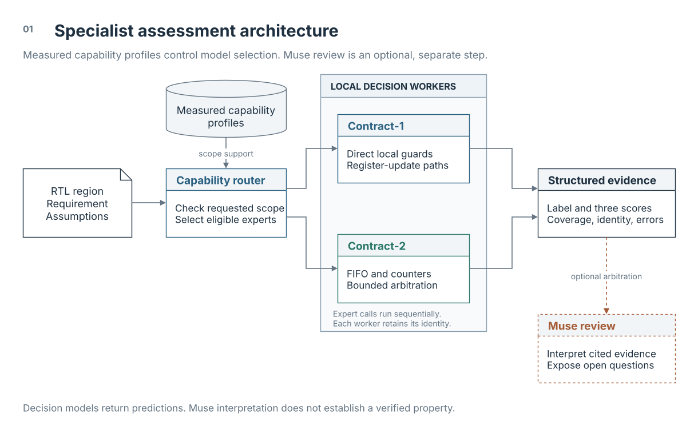
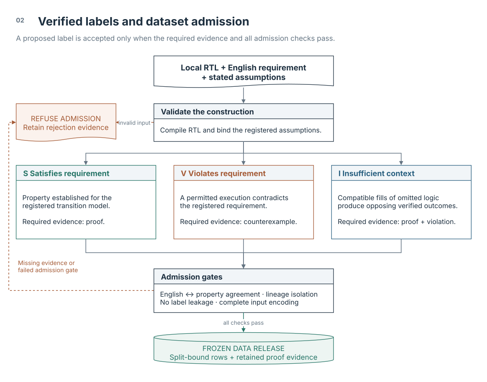
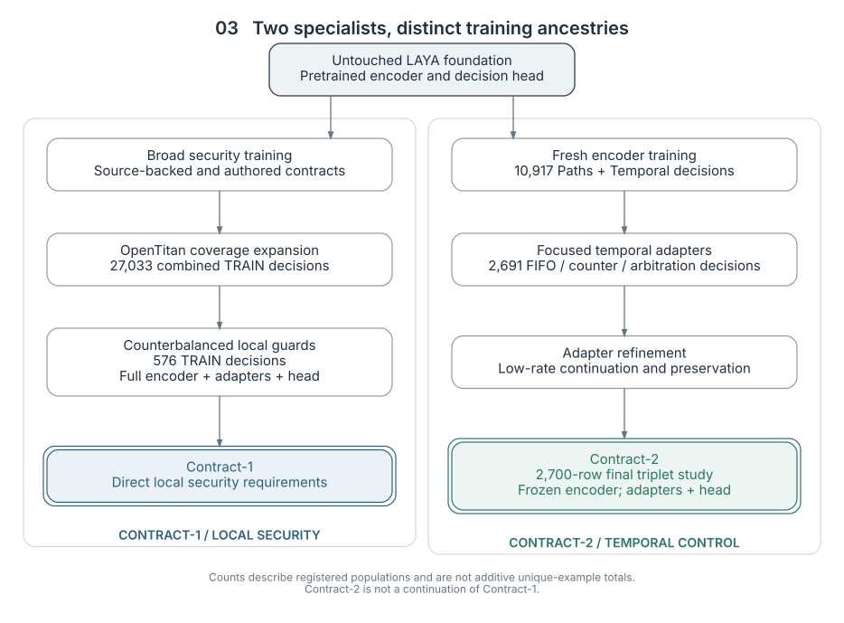
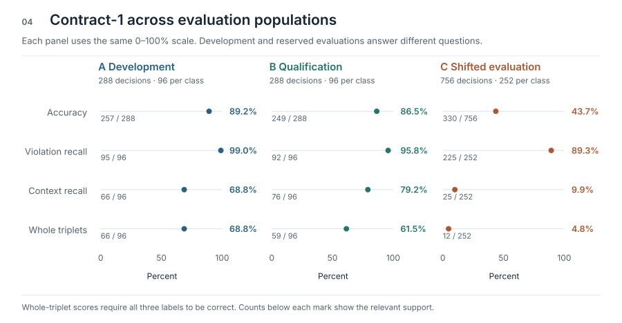
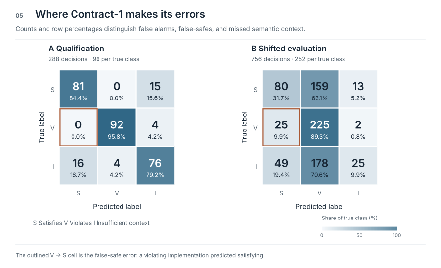
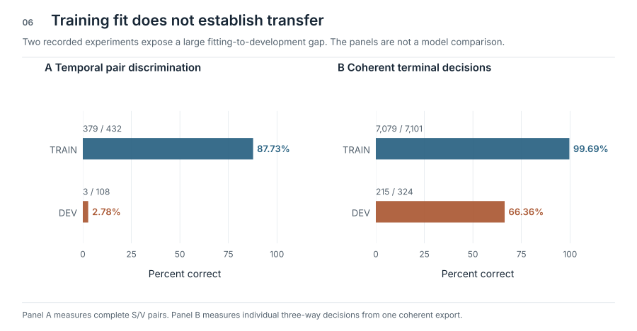
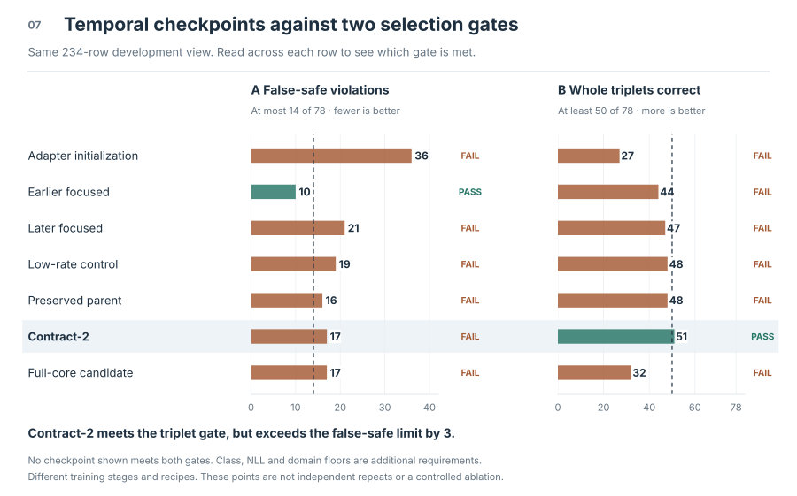
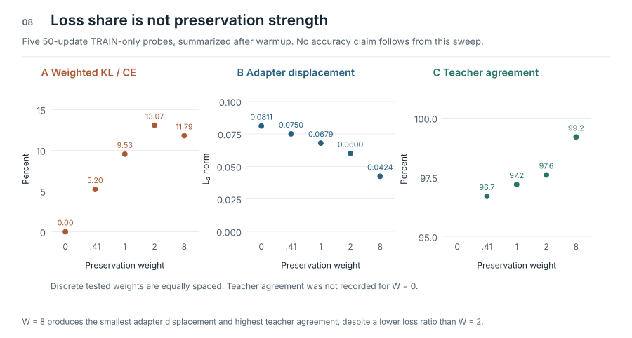
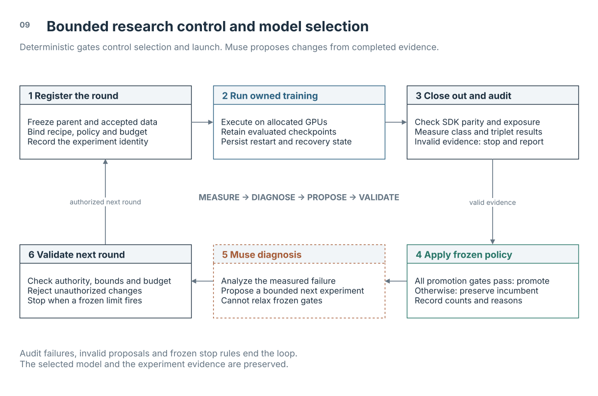

# SiliconShield

## Muse-guided research and specialist decision models for RTL security

Scientific white paper | 1 November 2026

[Documentation index](README.md)

### Abstract

RTL security review is a specification problem. An update that is correct under
one policy can violate another, and an omitted driver can make either conclusion
unjustified. SiliconShield studies whether small, local decision models can
provide useful requirement-conditioned assessments while a Muse agent manages
the surrounding investigation and model-development process. The system
separates three responsibilities: executable construction of training labels,
neural classification of an RTL requirement, and evidence-based agent decisions
about experiments and findings.

The research produced two specialist RTL decision models. Contract-1 addresses
visible local guards and register-update conditions. It scores 257/288 on
counterbalanced development, including 191/192 fully specified cases, and 249/288
on a
four-family reserved qualification population, with no false-safe prediction
among 96 violations. A separate wording and representation shift lowers accuracy
to 330/756. Contract-2 addresses bounded FIFO, counter, and arbitration
contracts. It scores 203/234 and completes 51/78 linked triplets on its
repeatedly used development population. Its release was an explicit research
selection after three frozen promotion gates failed.

The experimental record also includes OpenTitan coverage expansion, unsuccessful
preservation and full-fine-tuning trials, a distributed-gradient defect, and
bounded Muse-led research campaigns. The campaign controller preserves the
incumbent when a candidate fails registered constraints and uses completed
evidence to guide the next experiment. Experiments used three NVIDIA RTX PRO
4000 Blackwell GPUs and an NVIDIA DGX Spark. The principal result is a
reproducible specialist-development method with useful measured capabilities and
explicit failure boundaries. It is not a claim of general RTL verification or
autonomous security sign-off.

**Keywords:** RTL security, requirement-conditioned classification, Muse,
residual adaptation, counterfactual data, temporal contracts, constrained model
selection.

**Evidence scope.** This paper synthesizes recorded experiments and selected
underlying receipts. No training, inference, or solver run was performed to
prepare it. Development, reserved evaluation, authored diagnostics, and
execution qualification are identified separately throughout. Figures show
reported measurements without invented learning-curve points or statistical
error bars.

## 1. Research question and decision task

Hardware correctness depends on what a state element is allowed to do. A
configuration register may accept a normal write but reject an unprivileged
write. A FIFO may accept a push when space exists but hold occupancy when full.
Those distinctions depend on the requirement, every relevant update path, and
the supplied assumptions. Recognizing familiar signal names is insufficient.

SiliconShield represents one decision as x = (D, R, A), where D is a
self-contained RTL region, R is an explicit requirement, and A contains the
assumptions needed to interpret it. The model produces a distribution over three
labels and selects its largest score. It does not generate RTL or execute a
proof during this forward pass.

| Label | Semantic interpretation |
|---|---|
| Satisfies requirement (S) | The supplied implementation meets the stated local requirement under the assumptions. |
| Violates requirement (V) | A behavior of the supplied implementation contradicts that requirement under the assumptions. |
| Insufficient context (I) | Missing implementation or policy information can change the correct answer. |

These are the intended label meanings. A neural output is a prediction of a
label, not established evidence that its meaning holds. In particular,
insufficient context is a semantic class, not a general out-of-distribution
detector. Low confidence, a failed compiler, and a clipped input are different
conditions.

The research asks four questions. Can solver-backed, counterbalanced examples
teach dependence on both RTL and requirements? Can additional training improve a
specialist without degrading protected behavior? Which failures arise from data
coverage, optimization, implementation, or evaluation? Can Muse operate a
bounded research loop while deterministic checks retain authority over
admission, launch, and promotion?

The scope is local digital behavior under registered assumptions. The
experiments do not establish whole-chip security, arbitrary vulnerability
discovery, unbounded liveness, clock-domain-crossing correctness, cryptographic
correctness, or analog and physical-fault behavior. CWE identifiers describe
source provenance. No separate CWE classifier or vulnerability-localization head
was trained and validated.

### 1.1 Worked example: a privileged configuration register

Consider a configuration register that controls a hardware block. The security
requirement is plain English: **outside reset, the register must hold its value
unless a write is requested by a privileged requester.** Assume one rising-edge
clock, a synchronous active-low reset, a trusted privilege indication, and no
other writer to this register. Reset is explicitly exempt from the write rule.

```systemverilog
module guarded_cfg (
    input  logic       clk, rst_n,
    input  logic       wr_en, privileged,
    input  logic [7:0] wdata,
    output logic [7:0] cfg_reg
);
    always_ff @(posedge clk) begin
        if (!rst_n)
            cfg_reg <= 8'h00;
        else if (wr_en && privileged)
            cfg_reg <= wdata;
    end
endmodule
```

The absent final `else` is intentional. A clocked register retains its value
when no assignment executes. The privilege condition therefore protects the
only non-reset update path in this complete example.

| Supplied update condition | Contract outcome | Reason |
|---|---|---|
| `wr_en && privileged` | Satisfies requirement | Every non-reset write requires privilege. |
| `wr_en` | Violates requirement | An unprivileged write can change the register. |
| `wr_en && allow_write`, with the definition of `allow_write` omitted from the supplied region | Insufficient context, if opposing completions are established | Defining `allow_write` as `privileged` enforces the policy. Defining it as constant one permits an unprivileged write. |

A concrete violating trace takes `rst_n = 1`, `wr_en = 1`,
`privileged = 0`, an old register value of `8'h12`, and `wdata = 8'hA5`.
At the next rising edge, the guarded design retains `8'h12`. The missing-guard
variant writes `8'hA5`. The difference is an unauthorized state transition, not
a stylistic coding issue.

The missing-context row describes an **incomplete excerpt**, not a complete
module with an unconstrained authorization input. Its label requires two
compatible implementations of the omitted logic that change the answer. A low
model score or an unfamiliar signal name is not enough. If a second writer,
such as a debug path, is present, it must satisfy the same requirement too.

These are explanatory RTL constructions, not new model-evaluation cases. They
show what the three labels mean. They also show why the requirement matters:
the missing-privilege variant violates this security policy even though it may
implement an ordinary unrestricted-write specification correctly.

## 2. Muse and the decision models have different responsibilities

SiliconShield combines a language-model agent with non-generative decision
specialists. Muse can inspect experiment evidence, propose a hypothesis, prepare
a bounded study, and interpret specialist outputs. Contract-1 and Contract-2
score the supplied RTL question. A deterministic controller validates the
proposal and applies the registered rules. This separation makes the agent's
reasoning inspectable without making its prose the final authority for labels or
promotions.



*Figure 1. Measured capability profiles guide scope-based specialist selection.
Each local worker returns its own scores and execution evidence. Optional Muse
review interprets that evidence without turning a prediction into a verified
property. The model-development loop is separate and appears in Figure 9.*

[Editable draw.io source](whitepaper/figures/01-system.drawio).

The Muse coding agent performed research and campaign work under an
owner-defined charter. Harness² supplied a procedure-learning integration that
can propose and evaluate instruction changes [7]. Changes to agent instructions
and updates to decision-model weights are distinct interventions, each requiring
its own evaluation.

The current router uses requested mechanism scopes and measured capability
profiles. It preserves individual specialist scores, execution errors, coverage
gaps, and disagreements. Optional Muse arbitration returns a provisional
assessment with supporting evidence and open questions. This is
application-level expert routing, not a jointly trained neural mixture of
experts. Its advantage over the best single specialist has not been established
by a controlled evaluation.

A separate repair workflow can execute unchanged requirement and regression
checks against an original and candidate design. Authored repairs exercise that
workflow. They do not establish live Muse repair quality. The scientific results
below concern decision models, operational behavior, and training methodology
rather than an unmeasured end-to-end bug-finding rate.

## 3. Constructing labels that depend on the requirement

### 3.1 Source extraction and executable admission

The source-backed collections use HardSecBench and OpenTitan [3, 4]. Builders
extract local cones of RTL, expose boundary signals, register a requirement and
assumptions, and generate mutations, rewrites, and requirement counterfactuals.
Icarus compilation and Yosys SAT checks support admission [10]. The verification
applies to the constructed local model, not automatically to the original
upstream IP.



*Figure 2. Dataset admission separates proof, counterexample, and opposing
completion evidence. An unestablished result refuses admission. Semantic review,
lineage isolation, leakage checks, and complete input encoding must also pass
before the split-bound release is frozen. Related variants stay together.*

[Editable draw.io source](whitepaper/figures/02-data.drawio).

A satisfying label requires the registered property to hold under the proof
procedure. A violating label requires a reachable counterexample. Conditional
temporal properties need a reachable antecedent to avoid vacuity.
Missing-context labels require a declared omission and compatible satisfying and
violating completions. Solver failure or an unestablished verdict refuses
admission rather than becoming insufficient context.

Completion construction exposed a substantive implementation problem. Textually
replacing a missing wire with an expression can change precedence and width
semantics. The corrected adapter retains the declared wire and adds a checked
assignment to it. The fill is then evaluated at the declared width, and existing
uses retain their grouping. Expression restrictions reject injected statements
and self-reference. Separate discriminating solver cases checked precedence and
truncation behavior.

### 3.2 Semantic and leakage review

Solver correctness for an assertion does not guarantee that its English
requirement says the same thing. Review packets therefore bind the requirement,
assumptions, property, and rendered bytes. One expert-data release reconciled
785 source packets into 770 distinct final templates and narrowed 136
requirement texts to the supported property. That review was owner-authorized
model self-review, not independent human review.

Source relatives, rewrites, specializations, and counterfactual variants remain
in common lineage groups. Admission checks exact and normalized overlap against
protected populations, removes label-revealing comments, and runs the real
input-preparation path to reject truncation. Counterfactual policies reuse RTL
under different requirements. This prevents code-only classification from
solving the complete task, although requirement wording and generation templates
can still create shortcuts.

## 4. Dataset scale, coverage, and experimental units

The first broad collection contains 23,310 balanced decisions. Its training
partition has 15,894 decisions, development 2,610, calibration 2,214, and test
2,592. Across those partitions there are 262 split groups and 5,124 distinct RTL
bodies. The 15,894 training decisions represent 173 groups and 3,486 RTL bodies.
Decisions, source files, and independent design lineages must not be counted
interchangeably.

Training initially combines 15,048 HardSecBench-derived decisions and 846
OpenTitan-derived decisions. The broader source collection spans 257
HardSecBench modules and 40 CWE provenance categories. Initial OpenTitan
training covers five source files and 13 mechanism identifiers. Its early test
coverage is only one OpenTitan mechanism in a 90-decision group. Development and
calibration in that first collection contain HardSecBench material only.

| Training collection | Decisions | Purpose and coverage |
|---|---:|---|
| Initial source-backed training | 15,894 | Local security contracts, counterfactual requirements, mutations, and omissions |
| Combined OpenTitan expansion | 27,033 | 15,048 HardSecBench, 6,516 OpenTitan, 5,469 authored-transfer decisions |
| Fresh-foundation pilot | 10,104 | 3,368 triplets curated for new foundation-based training |
| Paths expert release | 3,816 | Multiple writers, helper indirection, and storage representations |
| Broad temporal expert release | 7,101 | State updates and bounded temporal control |
| Contract-1 final specialization | 576 | 192 counterbalanced local-write triplets |
| Focused temporal pilot | 2,691 | 1,719 FIFO, 900 counter, and 72 arbitration decisions |
| Contract-2 continuation | 2,700 | Focused pilot plus nine verified arbitration siblings |

These collections overlap and belong to different studies. Their counts must not
be summed as unique training data. The OpenTitan expansion adds 5,670 training
decisions from 51 source files, increasing combined OpenTitan training coverage
to 56 files. Its new development, calibration, and test partitions contain 180,
234, and 108 decisions, respectively, with three source groups in each.

The added OpenTitan contracts cover register and bus control, FIFOs, counters,
arbitration, reset, memory control, lifecycle and debug policy, alerts, entropy,
and local properties in cryptographic and key-management blocks. Coverage of a
source block means local extracted contracts, not verification of its full
security behavior.

The focused temporal population has 897 training triplets and 78 development
triplets. Its training and development groups are disjoint within that
construction, but both are assembled from historical training material. The
234-row development result is therefore an objective-selection measurement, not
fresh independent generalization.

The public training collection contains 19,050 rows. Its Contract-1 subset
includes 576 specialization rows and 15,774 follow-up-study rows that did not
replace the released model. Its Contract-2 subset contains 2,700 rows. The
public 5,589-decision benchmark includes development material across 11 design
areas. Neither public collection should be mistaken for an untouched evaluation
or the complete ancestry of both models [1, 2].

## 5. Architecture, numerical method, and compute

### 5.1 Decision-model architecture

The specialists use the LAYA decision runtime and a ModernBERT-large encoder [5,
6]. The inspected encoder configuration has 28 layers, hidden width 1,024, 16
attention heads, and feed-forward intermediate width 2,624. Full attention
occurs every third layer, with local attention in the intervening layers. A
question-and-option decision head scores the three alternatives. The configured
head has two layers. The unused action head is frozen in the security studies.

Residual bottleneck adapters are attached across all 28 encoder layers, with
bottleneck width 256 and scale 8 in Contract-1. Conceptually, an adapted hidden
state adds a learned bottleneck transformation to the layer output.

Training explicitly selects which parameters can change. Full-core runs train
encoder and decision head with adapters disabled. Adapter runs freeze the
encoder and train residual adapters plus the head. Partial-plasticity arms
unfreeze upper encoder blocks. Contract-1's final specialization trains the full
encoder, existing adapters, and decision head. Contract-2's final continuation
freezes the encoder.

Reported model evaluation uses BF16 computation and FP32 probability and metric
calculation. The security input budget is 1,536 tokens, with 256 tokens for
question and options. Training uses AdamW, gradient accumulation, clipping,
shuffled option order, and registered learning-rate schedules. Historical
software snapshots vary. Reproduction must match the objective implementation
and runtime, not only the learning rate.

### 5.2 Hardware used

| Platform | Configuration used | Research role |
|---|---|---|
| RTX workstation | Three NVIDIA RTX PRO 4000 Blackwell GPUs, 24 GB GDDR7 each | Three-rank distributed continuation, then separate single-GPU arms for controlled comparisons |
| NVIDIA DGX Spark | GB10 Grace Blackwell, 128 GB unified system memory | Contract-1 specialization, foundation and residual-adapter experiments |

The device specifications are consistent with NVIDIA's published descriptions
[8, 9]. The three RTX memories are separate device memories, not one
transparently pooled 72 GB allocation. Spark's unified memory is also not
directly comparable to discrete GPU VRAM.

Three-GPU decision-model runs commonly use 48 rows per optimizer update. Later
single-device triplet studies use microbatches of three and 16 accumulation
steps to preserve the same 48 row-visits. Contract-1 uses microbatches of six.
Grouped sampling keeps related decisions together and assigns explicit source or
mechanism mass. A row-visit budget is not proof of unique-row coverage.

## 6. Model ancestry and reproducible recipes



*Figure 3. Contract-1 and Contract-2 share a foundation but follow different
training histories. Contract-2 is not a continuation of Contract-1. Counts
beside stages describe registered training populations and are not additive
unique-example counts.*

[Graphviz DOT source](whitepaper/figures/03-lineage.dot).

### 6.1 Contract-1 specialization

The final local-guard run starts from the OpenTitan-expanded security
checkpoint. It uses 576 training decisions, a 288-row group-disjoint development
view, and ordinary three-way cross-entropy. All encoder, residual-adapter, and
decision-head parameters are trainable. Learning rate is 2 × 10⁻⁶ for those
groups, with ten warmup updates and cosine decay to one tenth of peak. The
effective batch is 48, clipping norm 1.0, seed 3301, and the ceiling is 250
updates. Evaluation and snapshot retention occur every 25 updates.

Eligibility requires at most eight false-safes, at least 48/96 correct in each
class, at least 10/96 whole triplets, and at least 159/288 correct overall.
Feasible candidates rank by fewer false-safes, stronger weakest-class count,
more whole triplets, more correct rows, and lower NLL. The released candidate
records 257 correct, class counts 96/95/66, and 66 whole triplets. Terminal
TRAIN fit reaches 576/576, which is a fitting result for a different training
position rather than an independent release metric.

### 6.2 Contract-2 continuation

Contract-2 inherits a frozen encoder trained from untouched foundation weights
on the combined Paths and broad-temporal curriculum. New temporal adapters were
then trained on the focused 2,691-row curriculum. Low-rate continuation,
semantic-margin experiments, and teacher-correct preservation produced the
parent of the final triplet study.

The final study trains adapters and the decision head at 1 × 10⁻⁷, with five
warmup updates and a hold-decay schedule ending at one fifth of peak. It uses
2,700 rows, seed 7502, effective batch 48, microbatch three, and evaluations
every ten updates. The horizon is 300 updates, with a minimum of 150 before an
exposure-aware plateau stop. The objective adds a worst-member triplet term of
weight 0.5 to row cross-entropy. Sampling weights are 4/3/1/7/1 for FIFO,
counter, arbitration, hard-triplet replay, and new siblings.

The owner selected an intermediate candidate after 70 updates for research
release. The trainer's protected selector retained its parent. The public source
documents the historical objective, but exact reproduction of this experiment
also needs the study-specific trainer that implemented it. Later general-purpose
trainer code must not be assumed to contain every historical auxiliary term.

## 7. Measuring learning without rewarding the wrong error

Let C be a confusion matrix in semantic order S, V, I, with true classes on
rows. Accuracy is the diagonal sum divided by N. Class recall divides each
diagonal entry by that class's support. A false-safe is C(V,S), a violation
predicted satisfying. A false violation is C(S,V), a satisfying case predicted
violating. Both matter, but they have different consequences in security triage.

Whole-triplet accuracy gives credit only when all three linked members are
correct:

$$T = \frac{1}{G}\sum_{g=1}^{G}\quad\prod_{i\in g}\mathbf{1}[\hat y_i=y_i].$$

A model that predicts every case as insufficient context can avoid false-safes
while failing the task. A model that predicts violation almost everywhere can
have high violation recall but little useful discrimination. Class recalls and
complete triplets expose both behaviors. A two-member satisfies/violates pair
metric is different from the three-member triplet metric.

Probability metrics include negative log likelihood, multiclass Brier score
summed over the three classes, and expected calibration error over ten bins.
They are computed from full-precision scores, not rounded display probabilities.
NLL and accuracy can move in opposite directions. Confidence is not a calibrated
correctness probability.

### 7.1 Selection as a constrained decision

A candidate must first satisfy the registered constraints. These can include
false-safe budgets, per-class floors, whole-triplet floors, family caps, and
retention requirements. A ranking orders candidates only under the declared
policy. Some studies preserve the initialization when no candidate is feasible.
Other studies explicitly retain the least-infeasible research candidate. A
research selection, automatic promotion, operational acceptance, and independent
qualification are separate outcomes.

One autonomous campaign initially chose lower transfer NLL over better retained
classification. Recovery of a saved intermediate checkpoint and a revised shared
ranking fixed that mismatch. The trainer and campaign now need the same frozen
reference and arithmetic. Family caps must name their population. Once a
protected view is perfect, a strictly positive gain requirement is unsatisfiable
and must be changed prospectively through an explicit policy amendment, never
silently after seeing a result.

### 7.2 Statistical unit and evaluation reuse

The independent unit is the design lineage or split group, not each rewritten
decision. Confidence intervals should resample whole groups when the group count
permits. Four qualification families, two shifted origins, or three held-out
source groups provide limited uncertainty estimates even when they generate
hundreds of rows. Kish effective sample size describes weighting dispersion, not
independence.

Repeated development selection is adaptive evaluation. It does not become an
untouched test because gradients never use its labels. A reserved population
becomes spent when its outcomes inform later work. The focused temporal
development set also has historical training exposure in its ancestry. No error
bar can repair that distinction. The paper therefore makes no
statistical-significance claim for small candidate improvements.

## 8. Broad security learning and OpenTitan expansion

The early source-backed model achieved 2,583/2,592, or 99.65%, on its historical
test. HardSecBench contributed 2,500/2,502 correct and no false-safes among 834
violations. OpenTitan contributed 83/90 correct, with seven false-safes among 30
violations, all within one mechanism. The same checkpoint scored only 27/93 on
an authored unfamiliar screen. Forty-seven of its 66 errors had confidence of at
least 90%. High familiar accuracy did not establish broad semantic transfer.

A transfer-focused continuation increased development accuracy from 46.22% to
94.36% and missing-context recall to 100%. It still failed a complete-clear
family cap and degraded retention. A subsequent autonomous campaign completed 15
rounds, preserving a recovered candidate with 621/621 transfer decisions and
2,604/2,610 retention decisions. Additional state-summary and raw-RTL
augmentations did not remove three persistent false-safes in one retention
family. The recorded campaign includes one recovered agent failure. This is
evidence of bounded execution and refusal, not uninterrupted scientific
progress.

### 8.1 Source coverage expansion produced a useful continuation

The OpenTitan expansion continued from that recovered candidate on 27,033
training decisions. It used three RTX GPUs, BF16 DDP, fresh optimizer state, a
200-update ceiling, and evaluation every 25 updates. Grouped triplet sampling
allocated 18 of every 48 rows to new OpenTitan, 15 to HardSecBench, 12 to
authored transfer, and three to earlier OpenTitan material. The selected
checkpoint occurred after 175 updates.

| Frozen development view | Parent | Expanded candidate |
|---|---:|---:|
| Transfer correct | 621/621 | 621/621 |
| Retention correct | 2,604/2,610 | 2,605/2,610 |
| Retention false-safes | 3/870 | 3/870 |
| OpenTitan correct | 170/180 | 180/180 |
| OpenTitan false-safes | 10/60 | 0/60 |
| OpenTitan complete triplets | 50/60 | 60/60 |

All ten OpenTitan development false-safes were in the I2C group and were
corrected. On the 5,670 new TRAIN rows, correct decisions increased from 5,281
to 5,663 and false-safes fell from 319 to seven. That TRAIN improvement is
separate from the held-out evidence.

The candidate scored 234/234 on new calibration and 108/108 on new test, each
containing three component groups. Later recorded parent scores were 229/234 and
99/108. These small local-contract populations support a component-scoped gain,
not OpenTitan-wide competence. Their results are now spent for subsequent
adaptive work. A fresh SDK reload reproduced the candidate's recorded frozen
development predictions, whose accuracy was 3,226/3,231. Accuracy and replay
agreement are different quantities.

## 9. Contract-1: useful local reasoning with a measured shift boundary

Contract-1's specialization corrects a concrete weakness: a model can perform
well on source-style data yet misread short prose-conditioned guards. The final
training population counterbalances the same local write situations across
requirements, rather than treating a familiar RTL pattern as universally good or
bad.



*Figure 4. Contract-1 development and reserved evaluations on a common
percentage scale. Direct labels show both percentages and exact counts. Decision,
class-recall, and whole-triplet denominators differ. The qualification and
shifted populations were scored under frozen protocols and are now spent. They
are not additional development views.*

| Population | Correct | Violation recall | False-safes | Whole triplets |
|---|---:|---:|---:|---:|
| Counterbalanced development | 257/288 | 95/96 | 0/96 | 66/96 |
| Four-family qualification | 249/288 | 92/96 | 0/96 | 59/96 |
| Requirement/context shift | 330/756 | 225/252 | 25/252 | 12/252 |

Development contains 191/192 correct fully specified decisions, or 99.48%. That
is a useful scoped result, not the accuracy over all three classes. The full
development accuracy is 89.24%. Reserved qualification reaches 86.46%, with
satisfies recall 84.38%, violation recall 95.83%, and context recall 79.17%. Its
four family accuracies range from 83.33% to 90.28%.

The shifted evaluation reaches 43.65%. It changes requirement phrasing, omitted
context, helper structure, and state representation. Context recall falls to
9.92%, while the model predicts violation on 562/756 rows. Thus 89.29% violation
recall under shift is partly a strong violation bias. The result does not
support general RTL reasoning.

On familiar retained development, Contract-1 scores 2,601/2,610 on
HardSecBench-derived contracts, 180/180 on OpenTitan local contracts, and
561/567 on authored transfer. It reaches only 340/738 on a
requirement-understanding stress view. The combined 3,682/4,095, or 89.91%, must
not conceal that weak slice.

### 9.1 Confidence and practical failure modes



*Figure 5. Confusion matrices show counts and percentages within each true
class. Both panels use the same 0–100% color scale. S denotes satisfies,
V violates, and I insufficient context. The outlined V-to-S cell identifies
false-safes. Qualification has 96 examples per class and shifted evaluation has
252. The dominant shift error is predicting violation for satisfying and
incomplete inputs.*

| Probability diagnostic | Qualification | Shifted evaluation |
|---|---:|---:|
| NLL | 0.7566 | 3.9405 |
| Brier score, summed over classes | 0.2360 | 1.0421 |
| ECE, ten bins | 12.13% | 50.16% |
| Errors with score at least 0.90 | 28/39 | 346/426 |

Zero observed false-safes in 96 qualification violations is encouraging within
that population. It does not establish a zero error rate. Under shift, 17 of 25
false-safes also carry scores above 0.90. A confidence threshold alone is
therefore not a demonstrated safety mechanism.

Authored diagnostics make the boundary concrete. A privilege-protected normal
write combined with an unprotected debug write was predicted satisfying at
99.74%. A clean lock-respecting design was predicted violating at 99.96%. A
small screen of unfamiliar missing-context patterns scored zero of six.
Conversely, six curated examples covering direct privilege guards, clear
enables, and exact-address conditions were all classified correctly. Those six
examples illustrate measured strengths, not unseen accuracy.

A separate 48-case presentation diagnostic on an earlier full-fine-tuned
checkpoint varied RTL form, requirement phrasing, and assumptions across two
mechanisms. It scored 31/48 and only nine of 24 matched pairs. Equivalent
simulated behavior changed predictions across direct and helper-wire renderings.
This supports representation sensitivity for that checkpoint. It does not prove
that every subsequent model has the same failure or that one syntax change is
universally harmful.

The practical operating envelope is a small, explicit contract with the relevant
writers and guard conditions visible. Multiple writers, indirect state updates,
hidden policy, and unfamiliar encodings remain important failure areas. Muse
interpretation should expose these gaps rather than convert a specialist's high
score into a verified finding.

## 10. Why more training was not enough

### 10.1 Fitting, exposure, and transfer were separate bottlenecks

Several temporal runs fit TRAIN pairs while barely improving development pairs.
One early continuation reached 379/432 TRAIN temporal pairs but only 3/108
development pairs. A coverage audit then found that a planned long horizon had
delivered only 1,938/3,393 hard examples before plateau stopping. The revised
recipe delivered all hard examples, but development remained at six of 108
pairs. Coverage was a real confound, yet fixing it did not solve transfer.



*Figure 6. Two separate diagnostic comparisons retain their original units and
supports. Panel A contrasts complete temporal S/V pairs on TRAIN and development
for an early continuation. Panel B contrasts individual decision accuracy for
the coherent terminal replay discussed in Section 14.1. These are different
experiments, not a controlled comparison between models. Neither high fitting
score establishes development transfer.*

Requirements also shifted style. In one plain-English campaign, the strongest
checkpoint reached 705/756 decisions and 203/252 whole triplets. Forty-nine of
its 51 errors occurred in a function-style subset, while the training population
contained no function declarations. Later helper augmentation changed replay
proportions and worsened both function and task-style performance. This supports
a data-support hypothesis, but the changes were confounded. No matched
replay-restoration control established a single cause.

### 10.2 Full fine-tuning changed the model, but not uniformly for the better

A fresh-foundation study trained encoder and decision head with residual
adapters disabled. After 750 updates on 10,104 rows, its selected candidate
scored 3,134/4,095 with 476 false-safes and 586/1,365 whole triplets. A second
round trained on 16,071 rows for 1,250 updates. Its selected candidate reached
3,384/4,095 with 385 false-safes and 880 triplets, but failed protected-source
and product checks. TRAIN fit reached 96.5%. The model was learning its
curriculum, but useful transfer and retention remained incomplete.

This trajectory refutes a simple “the optimizer cannot move the model”
diagnosis. It does not demonstrate that full fine-tuning is inferior in general.
The starting point, curriculum, schedule, and evaluation distribution all
matter. A matched 50-update initializer probe for the later local specialist
favored the OpenTitan-trained ancestor over a fresh-study intermediate: 149/288
versus 130/288 correct, zero versus 29 false-safes, and four versus two
triplets. That result justified the ancestor used for Contract-1's next study.

### 10.3 More plasticity did not repair violation recall

Three Contract-1 continuation arms trained adapters only, adapters plus the top
eight encoder blocks, and the full encoder. Their mixture emphasized requirement
and helper examples. Across 12 selection-eligible evaluations, none passed the
frozen gates. Target violation count remained 88/96 against a floor of 95, and
broad false-safes were 40–44 against a budget of 29. Training accuracy improved
to 87–89%, but training false-safes also rose.

The supported conclusion is a class tradeoff under that curriculum, not a proven
representation ceiling. Satisfaction and context gains did not compensate for
poorer violation recognition. The unchanged parent was the correct export under
the registered policy.

## 11. Contract-2: narrowing temporal reasoning to learnable local contracts

### 11.1 Worked example: occupancy at a FIFO boundary

A FIFO stores a bounded number of items. Its occupancy counter must describe
accepted operations, rather than blindly count requests. For a four-entry
queue, use this requirement: **occupancy stays between zero and four. A write
request is accepted only when the queue is not full, and a read request only
when it is not empty. Increase occupancy for an accepted write alone, decrease
it for an accepted read alone, and otherwise hold.**

The example uses one rising-edge clock and a synchronous active-low reset.
Acceptance is computed from occupancy immediately before the edge. Thus a
simultaneous push and pop at full occupancy accepts only the pop under this
particular policy. A design that permits replacement at full occupancy needs a
different acceptance rule. Neither policy should be inferred from the word
“FIFO” alone.

```systemverilog
module fifo_occupancy (
    input  logic       clk, rst_n, push, pop,
    output logic [2:0] count
);
    logic push_ok, pop_ok;
    assign push_ok = push && (count < 3'd4);
    assign pop_ok  = pop  && (count != 3'd0);

    always_ff @(posedge clk) begin
        if (!rst_n)
            count <= 3'd0;
        else begin
            case ({push_ok, pop_ok})
                2'b10:   count <= count + 3'd1;
                2'b01:   count <= count - 3'd1;
                default: count <= count;
            endcase
        end
    end
endmodule
```

| Occupancy before edge | Push / pop requests | Accepted operations | Occupancy after edge |
|---:|---|---|---:|
| 0 | 1 / 0 | Write only | 1 |
| 4 | 1 / 0 | Neither | 4 |
| 0 | 0 / 1 | Neither | 0 |
| 2 | 1 / 1 | Both | 2 |
| 4 | 1 / 1 | Read only | 3 |

Removing the full condition by changing the write-acceptance assignment to
`assign push_ok = push;` creates a boundary defect. Once occupancy is four,
a write request without a read must leave the count at four. The altered
implementation instead advances to five. The three-bit counter can represent
five, so this failure does not depend on arithmetic wraparound.

This occupancy contract says nothing about stored data ordering, pointer
synchronization, or an asynchronous FIFO. Those need their own supplied logic,
assumptions, and requirements. If the implementation of the admission predicate
is omitted, opposing compatible completions are needed before assigning
insufficient context. The example explains the local transition reasoning the
focused temporal curriculum seeks to teach.

### 11.2 From broad temporal scope to a focused task

Initial Contract-1 adapter continuations improved broad temporal row accuracy
from 177/324 to 218/324, yet whole triplets stayed at 6/108. Context recognition
improved while violation recognition degraded. A separate combined Paths and
temporal study restarted from untouched foundation weights and selected a
full-core checkpoint after 600 of 900 updates. Its temporal slice scored
194/324, with class counts 19/69/106 and six whole triplets. New residual
adapters on that encoder improved the slice to 219/324 and 15 triplets.
Satisfaction recall was still only 25.93%.

The next study narrowed the task to local FIFO, counter, and arbitration
behavior. The structured objective kept row cross-entropy and added
complete-versus-missing-context classification, complete-case compliance
classification, smooth worst-member loss, and sibling ranking:

$$L = L_{CE} + 0.20L_{context} + 0.20L_{compliance} + 0.10L_{worst} + 0.05L_{rank}.$$

For member losses l₁, l₂, l₃, the smooth worst-member term is τ[log Σ exp(lⱼ/τ)
− log 3], with τ = 0.25. Sibling ranking uses a 0.20 margin. Contiguous triplets
allow the loss to compare linked decisions directly. Training option
permutations are restored to semantic class order before class-specific terms
are applied.

Two single-device arms explored this formulation. Spark trained a full core from
untouched foundation weights. RTX trained new adapters and the head over the
previously trained frozen encoder. The Spark selected point reached 183/234 and
32/78 triplets. The RTX selected point reached 198/234 and 47/78 triplets. These
are not a controlled adapter-versus-full-fine-tuning comparison because their
parent exposure, schedules, and budgets differ.

### 11.3 The compliance boundary remained the difficult part

Within the RTX arm, an earlier checkpoint recognized 68/78 violations with ten
false-safes. A later checkpoint recognized 57/78 violations with 21 false-safes,
while gaining 13 satisfying decisions and lowering NLL. Context recall was
already perfect. Learning to identify complete context was easier than deciding
whether complete RTL complied with the requirement.

Follow-ups tested low learning rates, class margins, masked preservation,
flatter exposure, symmetric margins, and hard-triplet replay. Several selected
their initialization. A TRAIN audit of a strong temporal parent still found only
522/897 whole triplets correct, with 229 false-safes. This was unfinished
fitting as well as a transfer problem. It did not justify treating extra updates
or a stronger penalty as a guaranteed solution.

### 11.4 Contract-2 selection and the remaining tradeoff



*Figure 7. Each row names a checkpoint on the same 234-decision development
view. The left panel counts false-safes among 78 violations, with a maximum of
14. The right panel counts correct whole triplets among 78, with a minimum of
50. Dashed lines mark the limits, and explicit PASS/FAIL labels avoid relying on
color. Contract-2 passes the triplet gate but misses the false-safe gate. No
checkpoint shown meets both. These are separate training stages and recipes,
not a controlled ablation. Class, NLL, and domain floors are additional gates.*

[Plot source and aggregate counts](whitepaper/figures/plot_temporal.py).

The final worst-triplet continuation produced Contract-2 at 203/234, or 86.75%,
with class counts 64/61/78 and 51/78 whole triplets. It has 17 false-safes and
14 false violations. All 31 errors are confusions between satisfies and
violates, with no context error on this development population.

| Domain | Correct | Accuracy | Evaluation support |
|---|---:|---:|---|
| FIFO | 97/108 | 89.81% | 36 decisions per class |
| Counter | 92/108 | 85.19% | 36 decisions per class |
| Arbitration | 14/18 | 77.78% | Six decisions per class |

Compared with its immediate parent, Contract-2 gains three correct decisions and
three triplets, but loses one correct violation and adds one false-safe. NLL
increases from approximately 0.3494 to 0.3554. It fails three of ten frozen
floor checks: violations 61 below 64, false-safes 17 above 14, and NLL above its
parent. The trainer retained initialization. The owner separately selected the
intermediate candidate as a focused research release. Both facts are part of its
result.

The strongest measured scope is local occupancy and counter control, with
limited arbitration support. Commit/hold, arbiter-tree, empty-data-blanking, and
stored-word-hold cases remain difficult. On the broader 5,589-row benchmark,
Contract-2 scores 2,510 correct compared with Contract-1's 4,351. This supports
scoped specialist consultation rather than replacing the local-guard model with
the temporal model. The benchmark itself includes development data.

No independent temporal qualification is claimed. New qualification must exclude
the historical training ancestry and must be frozen before further optimization
or selection.

## 12. Preservation strength must be measured behaviorally

Distillation can preserve useful behavior, but a teacher can also preserve a
wrong boundary. The preservation studies therefore mask the teacher term to rows
where the frozen teacher's largest-probability label agrees with the verified
TRAIN label. No teacher prediction replaces the target label. For mask mᵢ and
temperature T, the term is:

$$L_{pres,i} = m_i T^2 D_{KL}(p_{teacher}^{(T)}(x_i)\parallel p_{student}^{(T)}(x_i)).$$

The total loss adds W times the masked preservation loss. A correct teacher
label does not prove that matching its entire distribution is optimal. The
method prevents direct imitation of known wrong argmax targets, but still needs
development tests for preservation and new learning.



*Figure 8. Five 50-update probes on the same 4,851-row TRAIN subset, summarized
after warmup. The tested weights are discrete categories, with no fitted curve.
Weighted KL divided by supervised CE is non-monotonic, while adapter movement
decreases and teacher-correct agreement increases. Agreement was not recorded
for the zero-weight control. These are optimization measurements, not accuracy
or independent preservation results.*

| Weight | Weighted KL / CE | Adapter displacement | Teacher-correct agreement |
|---|---:|---:|---:|
| 0 | 0% | 0.0811 | Not measured |
| 0.41 | 5.20% | 0.0750 | 96.7% |
| 1 | 9.53% | 0.0679 | 97.2% |
| 2 | 13.07% | 0.0600 | 97.6% |
| 8 | 11.79% | 0.0424 | 99.2% |

The ratio is weighted KL divided by supervised CE, not its fraction of total
loss and not a gradient ratio. Raw KL falls from about 0.202 at weight 0.41 to
0.029 at weight eight. Pre-clip norm rises from roughly 67 to 146, and the
control and strongest probe each clip all 26 post-warmup updates. AdamW and
global clipping further separate scalar loss magnitude from parameter movement.

The strongest behavioral constraint in this sweep is weight eight despite its
lower loss ratio than weight two. A repeated weight-two probe closely reproduces
displacement and ratio. The longer control/moderate/strong study was recommended
but not launched at the evidence cutoff. The finite sweep does not prove that
any desired loss ratio is mathematically unreachable or that preservation will
improve the final model.

## 13. Numerical execution and inference reproducibility

Numerical parity matters when comparing decision-model checkpoints. Some
identical BF16 temporal weights differ by one decision between Spark and RTX
execution. One Contract-1 local development replay similarly differs by one
context decision, while its broader 4,095-row replay matches. Comparisons should
name the runtime, precision, device, batch size, question contract, and option
order. Stable labels on one population do not imply cross-device identity on all
marginal cases.

The documented release rehearsal uses Python 3.11.15, Torch 2.14.0 with CUDA
13.0, Transformers 5.5.0, Safetensors 0.8.0, and NumPy 2.4.6 on RTX PRO 4000
Blackwell. Historical training snapshots include other library versions. This
release tuple describes tested inference, not a claim that every reported
experiment used one universal environment.

## 14. Execution defects that changed the scientific interpretation

### 14.1 Distributed backward coherence

A pair-loss implementation issued two backward calls per microbatch under DDP
and produced rank divergence. A real three-GPU probe measured a maximum
cross-rank gradient difference of approximately 0.183 and parameter difference
of 0.020 after the first update. The rank-zero gradient differed from a combined
single-device reference by 0.104. These were implementation errors, not evidence
of unstable hardware or an inherently defective distributed-training method.

The correction combines all loss terms into one scalar and calls backward once
per microbatch. Non-final accumulation microbatches remain inside no_sync(). The
corrected probe produces zero cross-rank differences and matches the
single-device reference within 1.2 × 10⁻⁷ across the checked updates. A unit
test over leaf tensors had not exercised the actual distributed reducer and was
insufficient to detect the defect.

Affected gathered evaluations combined predictions from different rank-local
models. They cannot be interpreted as the accuracy of one export. A coherent
replay of the saved terminal rank-zero artifact scores 215/324, or 66.36%, while
TRAIN fit reaches 7,079/7,101, or 99.69%. The fitting-to-transfer gap is real
for that saved artifact, but mixed-rank events are excluded from model-quality
comparisons. Not every earlier temporal failure used the affected
implementation.

### 14.2 Other bottlenecks and corrections

| Bottleneck | Consequence | Correction or remaining boundary |
|---|---|---|
| Budget exit skipped final evaluation | A completed run could export a stale initial selection | Evaluate final weights before restoring the best checkpoint |
| Duplicate optimizer-group log names | Adapter gradient norm was severely understated | Aggregate by module membership and record parameter displacement |
| Semantic margin used shuffled slots | Class penalties could target the wrong alternative | Restore semantic order and test all six permutations |
| Planned exposure exceeded executed horizon | “Full coverage” was claimed without all rows being drawn | Reconstruct delivered draws and gate plateau on measured coverage |
| Display probabilities used for NLL | Rounded zero scores produced artificial infinite losses | Compute from full logits under the pinned scoring path |
| Preferred snapshots were not retained | Retrospective selection could not recover the model | Save every evaluated candidate needed for later review |
| SDK load modified export metadata | A later manifest bound transient bytes | Stage mutable configuration and verify immutable export contents |
| Trainer and campaign ranked differently | Useful candidates could be lost or infeasible ones preferred | Freeze and share constraints, population references, and ranking |

The correction of execution defects improves the validity of later experiments.
It does not retroactively make invalid measurements valid or turn a failed model
into a successful one. Historical negative results remain separated by whether
the implementation was coherent enough to support a scientific claim.

## 15. A bounded negative-feedback research loop

The unattended controller treats training as a sequence of registered
experiments. It observes the selected and terminal artifacts, audits fitting and
exposure, computes fixed metrics, and asks Muse for a diagnosis and next
proposal. The proposal can change only authorized fields. Deterministic
admission, resource ownership, and promotion checks determine what actually
executes.



*Figure 9. The cycle separates owned training, evidence audits, frozen model
selection, Muse diagnosis, and validation of the next proposal. Passing
promotion gates can change the incumbent. Failing them preserves it. Invalid
evidence, unauthorized proposals, and frozen stop rules end the loop. Feedback
changes future experiments, not the current acceptance rule. This is an
operational control analogy, not a formal stability proof.*

[Editable draw.io source](whitepaper/figures/09-feedback.drawio).

A round freezes the parent and incumbent, dataset and sampling pools, recipe,
reporting contract, and policy. Owned systemd jobs and idempotent submission
prevent duplicate work after controller failure. Recovery reads persisted state
and requires compatible optimizer, position, best-checkpoint, and random-number
state. Policy and input bindings are checked again after resource waits and
before launch or promotion.

The autonomous campaign's strongest demonstrated behavior was refusal. It
preserved useful checkpoints when subsequent data doses increased dangerous
errors, refused initialization-equivalent “improvements,” and stopped repeated
ineffective interventions. That is valuable research infrastructure even when
the next hypothesis fails. It is not evidence that negative feedback alone
converges to a high-quality model.

The loop also exposed operational bottlenecks. Stale ownership checks,
submitted-job reattachment, and report-phase recovery needed explicit fixes. A
healthy watcher that never analyzes a completed job is not a productive research
loop. Completion-to-analysis delay, delivered coverage, and repeated null
outcomes belong in operational monitoring alongside GPU activity.

Model selection cannot be delegated to optimistic prose. The agent may explain
why a trial was interesting, but a failed class floor or false-safe budget
remains a failed gate. An owner may make a separate research-release decision,
as with Contract-2, provided that the record preserves the distinction.

## 16. Specialist routing and the next research boundary

The two released models support a practical architecture: route explicit local
guards to Contract-1 and bounded FIFO, counter, and arbitration requirements to
Contract-2, subject to measured capability profiles. A request outside both
supported domains should remain visibly unsupported. Consulting two weak models
does not create a qualified expert by aggregation.

The current implementation requires each selected profile to cover every
requested scope tag. Partial coverage can motivate splitting the question, but
is not treated as complete support. Profiles bind measurements to the executed
model and inference configuration. Errors and missing capability data remain
visible. Experts are consulted sequentially, and Muse can interpret their
individual evidence without replacing it with an untraceable vote.

The next controlled evaluation should compare a fixed single-model baseline,
deterministic capability routing, and routing with Muse interpretation on the
same new population. Outcomes should include correct decisions, false-safes,
whole triplets, unsupported-scope handling, evidence fidelity, and latency. The
requested scope should be supplied independently when measuring the router, and
inferred-scope performance should be a separate condition. This would
distinguish better specialist selection from better explanation.

### 16.1 Data and optimization priorities

Future data should vary semantics and representation independently. Add complete
satisfying and violating examples for every omission pattern. Enumerate all
writers, including debug and helper paths. Cover reset exemptions, priority,
width, encoded storage, and helper definitions explicitly. Use new source
lineages for qualification rather than renaming old training material.

For the temporal model, prioritize the satisfies/violates boundary on FIFO
occupancy, counter transitions, and grant conditions. Context recognition is
already strong on the focused development view. A new objective should be
compared against plain cross-entropy with matched initialization, sampling
draws, update budget, and at least repeated seeds. Both false-safes and false
violations must improve without relying on abstention.

## 17. Validity, reproducibility, and conclusions

### 17.1 What the evidence supports

The experiments establish that requirement-conditioned local RTL specialists can
be trained on workstation-class hardware and integrated with Muse-mediated
research and assessment. Contract-1 shows useful local-guard discrimination
under a narrow independent qualification protocol. OpenTitan expansion improves
measured local-contract coverage. Contract-2 improves a focused temporal
development frontier while leaving a substantial compliance-error rate. The
campaign record demonstrates recoverable execution and explicit refusal when
candidates fail registered constraints.

The record also establishes practical methodological lessons. Whole-triplet
metrics reveal failures hidden by row accuracy. Delivered exposure must be
measured. Prediction scores are poorly calibrated under shift. Teacher-correct
preservation needs behavioral diagnostics. Distributed execution and semantic
option handling require tests at their real component boundaries. Training
completion, candidate selection, release choice, and independent qualification
are different events.

### 17.2 What remains uncertain

Most studies are adaptive, single-seed comparisons with small group counts. Some
vary parent, learning rate, objective, and curriculum simultaneously. Those
trials can establish whether a recipe met its gates, but cannot isolate causal
effects. No general superiority of adapters, full fine-tuning, a loss term, or a
hardware platform follows from them.

Source-cone extraction and plain-English rendering are part of label validity.
Model self-review is not independent human review. Formal checks remain limited
by the registered transition model and assumptions. Perfect scores on a few
component groups do not establish full-IP security, and raw confidence does not
bound risk.

### 17.3 Reproduction and release evidence

The public repository provides model-loading, routing, data, reporting, and
study infrastructure. Public models and dataset collections expose part of the
research [1, 2]. Exact historical reproduction additionally needs the
appropriate trainer, actual sampled exposure, runtime behavior, and saved
evaluation protocol. Selected auxiliary-loss implementations belong to
historical study snapshots rather than every current trainer.

This white paper omits machine paths, cryptographic identifiers, and internal
experiment aliases for readability. Their omission does not remove the need to
verify immutable artifacts when reproducing a study. Release manifests and
retained receipts provide that operational layer. The paper itself is an
evidence synthesis, not a new independent reproduction of every reported run.

Contract-1 qualification and shifted results were reconciled against saved
records for the released artifact. The OpenTitan replay statement was reconciled
against its completion record. Conflicting later manuscript prose was not
carried into this paper. No saved model, dataset, evaluation outcome, or
original manuscript was changed during preparation.

**Conclusion.** SiliconShield's contribution is the combination of local
decision specialists, executable data construction, and an auditable Muse
research loop. Its strongest results arise when the question is explicit and the
training population matches the intended reasoning task. Its failures show why
broader data, longer runs, and more agent autonomy do not substitute for
coherent execution, balanced semantic tests, and preserved evaluation
boundaries. This provides a concrete foundation for improving both the
specialists and the agents that use them.

## References and public research resources

[1] SiliconShield contributors. *SiliconShield source, model documentation,
training recipes, and evaluation infrastructure.* See the [project
introduction](../README.md) and [documentation index](README.md).

[2] SiliconShield model and data releases. [Contract-1 and Contract-2 model
card](siliconshield-rtl.md), [training collections and
recipes](training-recipes.md), and [RTL benchmark](benchmark.md).
Release and population descriptions in this paper were checked against local
documentation and retained records. Public Hub access was not independently
revalidated for this paper.

[3] HardSecBench contributors. *HardSecBench.* Source use and extraction scope
are described in the [data pipeline](data-pipeline.md#sources-and-builders).

[4] lowRISC contributors. *OpenTitan.* https://github.com/lowRISC/opentitan

[5] LAYA contributors. *LAYA: local non-autoregressive decision engine.*
Project attribution and compatible-runtime details are collected in the
[dependency notices](../NOTICE.md) and [release guide](releases.md).

[6] Answer.AI and collaborators. *ModernBERT-large.*
https://huggingface.co/answerdotai/ModernBERT-large. Architecture dimensions in
this paper come from the inspected model configuration.

[7] Harness² contributors. *Harness²: Recursive Agent Harnessing for an Open
World.* 2026. https://arxiv.org/abs/2610.14224

[8] NVIDIA. *DGX Spark.*
https://www.nvidia.com/en-us/products/workstations/dgx-spark/

[9] NVIDIA. *RTX PRO 4000 Blackwell.*
https://www.nvidia.com/en-us/products/workstations/professional-desktop-gpus/rtx-pro-4000/

[10] YosysHQ contributors. *Yosys Open SYnthesis Suite.*
https://yosyshq.net/yosys/. Icarus Verilog contributors. *Icarus Verilog.*
The [data pipeline](data-pipeline.md) describes how these tools support label
admission.

**Source note.** Numerical study results are original SiliconShield experimental
records synthesized from the research manuscript, saved metric reports, dataset
audits, calibration receipts, release documentation, and candidate-selection
records. External references describe foundations and methods rather than
independently validating SiliconShield's measurements. No cumulative GPU-hour,
energy, or cost total is reported because the available records do not provide a
complete, comparable accounting.
