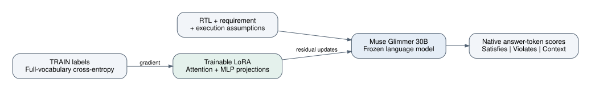
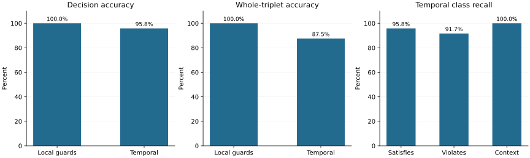
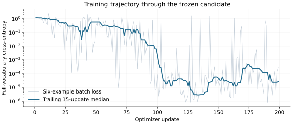
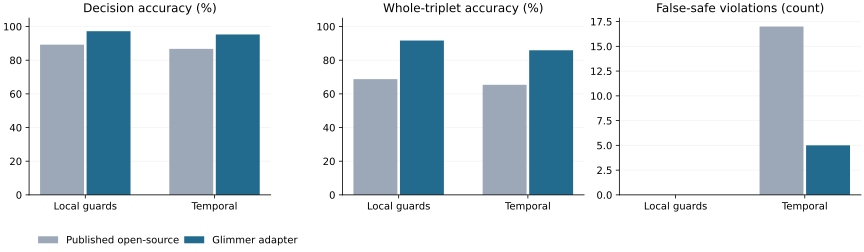

# SiliconShield: adapting Muse Glimmer for RTL requirement decisions

Scientific research report | 4 November 2026

[Documentation index](README.md)

## Abstract

Hardware review asks a conditional question: does this implementation satisfy this requirement under these assumptions? We study supervised adaptation of Muse Glimmer 30B to answer that question with three decisions: satisfies requirement, violates requirement, or insufficient context. The experiment reuses the final specialization population associated with Contract-1 and the focused training population associated with Contract-2. It trains a single low-rank adapter on the Meta language model, rather than transferring the encoder weights or decision heads of the earlier open-source models.

The available training population contains 3,276 decisions arranged in 1,092 balanced triplets. At the frozen candidate's 199th optimizer update, 1,194 distinct training decisions had been delivered. On a preselected 144-decision development monitor, the frozen model classified 141/144 decisions correctly: 72/72 local-guard decisions and 69/72 focused temporal decisions. It completed 45/48 whole triplets correctly. One temporal violation remained incorrectly labeled satisfying.

After freezing, a fresh process scored the candidate on all 522 development decisions. It achieved 280/288 (97.22%) on local guards and 223/234 (95.30%) on focused temporal contracts, with 88/96 and 67/78 whole triplets correct. The corresponding published open-source models reported 257/288 and 203/234 correct decisions. Temporal false-safes decreased from the published 17/78 to 5/78. Local-guard false-safes remained zero, although violation recall decreased from 95/96 to 93/96. This historical comparison supports stronger aggregate and triplet performance across both domains, not uniform superiority on every class.

Execution required diagnosis of corrupt cross-device tensor transfers and a later memory failure. CPU-staged device transfers restored finite forward and backward computation. The evaluated candidate was preserved before the memory failure and frozen at the owner's request. These results establish a promising supervised adaptation on existing development populations. They do not establish independent generalization, calibrated security probabilities, or formal correctness.

**Keywords:** Muse Glimmer, RTL, security requirements, supervised fine-tuning, LoRA, counterfactual datasets, numerical reproducibility.

## 1. Research question and contribution

The earlier SiliconShield work trained models built on another open-source foundation for visible guards and focused temporal contracts. This study asks a different architectural question: can a general Muse language model acquire the same three-way decision interface through a small supervised adaptation, using the existing task data?

The contribution is an evaluated candidate and a reproducible account of its construction. The study combines native language-model token prediction, a plain-English specification interface, counterbalanced examples, whole-triplet measurement, and explicit separation between training, development selection, and verification of the saved artifact. It also records failures that would otherwise make the apparent training trajectory misleading.

Muse Glimmer is the model being adapted in this study. This is different from earlier experiments in which Glimmer operated a training workflow while another model learned the decision task. The focused experiment used a scripted trainer and automated evaluation. It does not establish that Glimmer autonomously designed or operated its own adaptation.

Figure 1 shows how the adapter is used. The capability router sends a
declared scope to the specialist for the matching contract domain, and Muse
reviews the returned evidence with its open questions.


*Figure 1. Assessment architecture: the router consults the specialist for the matching contract domain and Muse reviews the returned evidence.*

## 2. Decision semantics and digital-design examples

An input consists of an RTL region, an English requirement, and execution assumptions. The three classes have the following intended meanings.

| Class | Dataset semantics |
|---|---|
| Satisfies requirement | The requirement holds for the allowed behaviors under the assumptions. |
| Violates requirement | An allowed behavior contradicts the requirement. |
| Insufficient context | Omitted information admits compatible completions with different outcomes. |

At inference these are model predictions. The model does not run a solver. Insufficient context is not interchangeable with uncertainty, unfamiliar syntax, or a tool error.

### 2.1 Privilege-qualified register writes

```systemverilog
module topmodule(
  input logic clk, rst_n, wr_en, privileged,
  input logic [7:0] wdata,
  output logic [7:0] cfg_reg
);
  always_ff @(posedge clk) begin
    if (!rst_n) cfg_reg <= 8'h00;
    else if (wr_en && privileged) cfg_reg <= wdata;
  end
endmodule
```

**Requirement:** Outside reset, `cfg_reg` may change only when `privileged` is asserted.

**Assumptions:** Two-state synchronous logic, defined inputs that may vary independently, and reset exempt from the requirement.

The complete guarded design satisfies this local requirement. Removing `&& privileged` permits an unauthorized update. For example, with reset inactive, `wr_en=1`, `privileged=0`, and write data different from the stored value, the next rising edge changes the register. Replacing the guard with an omitted authorization expression creates a context question only when permitted completions of that expression can change the outcome.

A request-enable check and a privilege check serve different purposes. The requirement concerns authorization, so detecting `wr_en` alone does not establish satisfaction. Every writer to the register must respect the same policy.

### 2.2 Simultaneous push and pop

```systemverilog
module topmodule(
  input logic clk, rst_n, push, pop,
  output logic [3:0] count
);
  always_ff @(posedge clk) begin
    if (!rst_n) count <= 4'd0;
    else case ({push, pop})
      2'b10: count <= count + 1'b1;
      2'b01: count <= count - 1'b1;
      default: count <= count;
    endcase
  end
endmodule
```

**Requirement:** Outside reset, when push and pop are both asserted, count must remain unchanged.

With two-state controls sampled on the rising edge, `2'b11` takes the default branch and preserves the count. Adding `2'b11: count <= count + 1'b1;` violates the requirement. Giving push priority in an `if`/`else if` chain also increments on simultaneous requests.

This requirement does not specify overflow, underflow, full/empty handling, or correspondence between occupancy and stored data. Satisfying it cannot establish that an entire FIFO is correct. Although the dataset is called temporal, this study's scope is bounded local transition behavior and associated counter and arbitration contracts, not arbitrary multi-cycle temporal logic.

These code examples explain the task. Separate authored inference checks are reported only when their execution completes.

## 3. Data construction and scope

| Population | Training decisions | Training triplets | Development decisions | Development triplets |
|---|---:|---:|---:|---:|
| Contract-1 specialization anchor | 576 | 192 | 288 | 96 |
| Contract-2 focused contracts | 2,700 | 900 | 234 | 78 |
| Total | 3,276 | 1,092 | 522 | 174 |

Each population is balanced over the three labels. The first population contains counterbalanced local write-path requirements. In those constructions, the same RTL can receive different labels when the requirement selects a different protected object. The second covers focused FIFO, counter, and arbitration contracts and includes verified sibling examples.

This is not the complete historical training curriculum of either released open-source model. In particular, the earlier broad Contract-1 ancestry is not reproduced. The publicly released research collection is also larger than the population used here. Describing this run as training on all historical SiliconShield data would be incorrect.

Input construction passes only the state text, containing requirement, assumptions, and RTL, through a fixed prompt. Expected labels, proof records, source identifiers, and selection metadata are not model input. Curation checks confirmed complete triplets, balanced labels, accepted proof metadata, and no intersections between TRAIN and DEV in row identifiers, exact state text, or registered split groups. Accepted proof metadata was inherited from the source datasets. Solvers were not rerun for every row during this focused study.

The encoded TRAIN population contains 1,874,886 input tokens. The DEV population contains 276,892. The longest training input contains 766 tokens, below the 2,048-token rejection limit. Inputs were not shortened to fit. Exact disjointness checks do not establish independence from the base language model's pretraining corpus or exclude every form of semantic similarity.

## 4. Model and optimization



*Figure 2. Native Glimmer text processing supplies three registered answer-token scores. Only LoRA parameters change. Dataset evidence remains outside the inference input.*

| Component | Configuration |
|---|---|
| Foundation | Muse Glimmer 30B |
| Adapted path | 52-layer language decoder |
| Frozen components | Base parameters and original vocabulary output head |
| Trainable parameters | 47,923,200 LoRA parameters |
| LoRA configuration | Rank 8, scale parameter alpha 16, dropout 0 |
| Target projections | Attention query, key, value, output and MLP gate, up, down |
| Numerical execution | BF16 base computation, higher-precision loss and adapter optimization |
| Optimizer | AdamW, peak learning rate 0.0001, weight decay 0.01 |
| Schedule | Ten-update warmup, wall-time cosine decay toward 20% of peak |
| Effective batch | Six decisions, containing two complete triplets |
| Microbatch | One initially, three after a qualified resume, then one after memory failure |
| Gradient control | Activation checkpointing and global norm clipping at 1 |
| Initialization | Original Glimmer base with newly initialized LoRA |

The native chat template fixes the system instructions, answer channel, date field, and reasoning-strength setting. The model is trained to predict one of three single-token answers. The loss is full-vocabulary next-token cross-entropy on the correct answer token:

$$
\mathcal{L}(x,y)=-\log p_\theta(t_y\mid x).
$$

No rationale is supervised. No teacher, encoder, or decision head from the earlier open-source models is loaded. At inference the three registered token logits are normalized to produce decision scores:

$$
q_k=\frac{\exp z_{t_k}}{\sum_{j=1}^{3}\exp z_{t_j}}.
$$

These conditional scores differ from full-vocabulary token probabilities. The evaluation also records the combined full-vocabulary mass of the three tokens. Neither form is a calibrated probability that the design is correct.

Sampling shuffles complete triplets without replacement and interleaves one local-guard triplet with four focused-contract triplets while both pools remain. Six-row optimizer batches preserve complete triplets. The selected checkpoint had seen 1,194 unique rows, approximately 36.4% of the available TRAIN population. This is partial exposure, not a completed epoch. A wall-time learning-rate schedule means interruptions can change the rate used on a resumed update. This run is not a controlled microbatch-size ablation.

## 5. Hardware and execution failures

Training used three NVIDIA RTX PRO 4000 Blackwell GPUs with approximately 24 GiB of memory each. The language decoder was partitioned across the devices, with 20, 20, and 12 layers respectively. Unused vision components remained on CPU. DGX Spark was not used for optimizer steps in this experiment. Existing local serving was preserved.

The successful runtime used Python 3.11, Torch 2.14.0 with CUDA 13.0, Transformers 5.21.0, PEFT 0.21.2, and Accelerate 1.15.0. Optimizer updates operated on one partitioned model, not three independent replicas or a distributed data-parallel ensemble.

### 5.1 Loading and numerical qualification

Initial attempts produced nonfinite values and did not deliver valid optimizer updates. Both quantized and BF16 probes were affected. Full base-weight integrity checks agreed with the upstream artifacts. Moving the base from rotational storage to SSD reduced observed loading from roughly five minutes forty seconds to approximately eighteen to twenty-two seconds. That change improved startup time, not learning quality.

Direct tensor-copy probes then identified a concrete execution defect. Transfers from a lower-numbered CUDA device to a higher-numbered device returned corrupted values in tested FP32, BF16, and integer tensors. Same-device and reverse-direction probes passed. Reported peer accessibility did not predict correct transfer behavior. The lower-level driver, interconnect, and mapping cause was not isolated, so the result must not be described as proven physical hardware failure.

### 5.2 Transfer repair

Cross-device tensors were staged through host memory. The differentiable copy path also carried backward transfers through the host. All nine source/destination combinations passed the implemented forward and backward probes. Global gradient norms were accumulated on CPU, avoiding another cross-device scalar transfer during clipping. Full-model checks then established finite outputs, finite gradients, and nonzero adapter parameter changes.

This workaround is part of the evaluated execution configuration. Replacing it with direct peer copies on the affected environment requires new numerical qualification. It incurs transfer overhead and limits throughput. The evidence does not support extrapolating this fault to every earlier distributed experiment.

### 5.3 Memory failure and preservation

A larger microbatch passed the implemented longest-input qualification, but the subsequent run failed with a CUDA memory allocation error after update 217. A synthetic or selected-input memory probe did not guarantee sufficient headroom for the entire run. The evaluated update-199 checkpoint and optimizer state had already been written safely. Training resumed from that checkpoint with a one-row microbatch. Restored adapter tensors matched exactly and optimizer state was loaded.

The owner then requested freezing the reported candidate. Update 199 was preserved separately. The resumed run stopped at update 217. Its terminal monitor scored 71/72 on local guards and 70/72 on temporal contracts, with zero and one false-safe respectively. The registered ranking preferred that terminal state through improved worst-domain triplet accuracy. The owner-frozen candidate remains update 199, which had been the reported candidate when freezing was requested. Later updates and terminal closeout results are not substituted for its reported metrics. This distinguishes the selected research artifact from the last model held in GPU memory.

## 6. Evaluation protocol

A seeded monitor selected 24 complete triplets from each domain before any model predictions. It contains 144 decisions. The candidate was scored using the registered prompt, answer tokens, precision, and execution path. Monitoring approximately every thirty-five minutes limits evaluation cost but leaves a sparse learning curve.

The registered ranking first minimizes the largest domain false-safe rate, then maximizes the smaller domain whole-triplet accuracy, then the weakest class recall, mean domain accuracy, and finally mean negative log likelihood. The experimental protocol retained the original initialization as a fallback, but this paper reports the frozen fine-tuned candidate. This is a research ranking, not a production acceptance threshold.

A false-safe is a violation predicted as satisfying. A violation predicted as insufficient context is also missed, but is counted separately. A whole triplet receives credit only if all three linked decisions are correct:

$$
T=\frac{1}{G}\sum_{g=1}^{G}\prod_{i\in g}\mathbf{1}[\hat y_i=y_i].
$$

Triplets and generated families create statistical dependence among rows. We report exact counts rather than attach unsupported independent-row confidence intervals. Development data informs candidate choice. The remaining development rows enlarge the measured population but do not become an independent final test.

## 7. Frozen candidate: development-monitor results



*Figure 3. Accuracy, complete-triplet rate, and temporal class recall for the frozen fine-tuned model. Each domain contains 72 decisions and 24 triplets. These are selection-used development measurements.*

| Domain | Correct decisions | False-safes | Whole triplets |
|---|---:|---:|---:|
| Local guards | 72/72 | 0/24 violations | 24/24 |
| Focused temporal | 69/72 | 1/24 violations | 21/24 |
| Combined | 141/144 (97.92%) | 1/48 violations | 45/48 (93.75%) |

| Domain | Satisfies recall | Violates recall | Context recall | Conditional NLL |
|---|---:|---:|---:|---:|
| Local guards | 24/24 | 24/24 | 24/24 | 0.0124 |
| Focused temporal | 23/24 | 22/24 | 24/24 | 0.2564 |

The three temporal errors comprise one satisfying case predicted violating, one violation predicted satisfying, and one violation predicted insufficient context. Mean label-token mass is approximately 0.9999 for local guards and 1.0000 for temporal examples. This indicates adherence to the three-token output format, not calibrated confidence.



*Figure 4. Each point is a recorded six-example training batch. The trailing median summarizes noisy batch losses, not validation performance. The curve includes the checkpointed microbatch transition. Falling training loss alone does not establish transfer.*

## 8. Fresh-process validation and practical examples

The following results were recorded after the frozen adapter was reloaded and scored. This verification uses the frozen candidate, not the latest training checkpoint. It compares saved monitor predictions and probabilities against the fresh process. Six authored examples cover guarded and missing-guard writes, simultaneous push/pop hold and increment, and omitted helper definitions.

### 8.1 Full development evaluation after freezing

| Domain | Frozen correct | False-safes | Whole triplets |
|---|---:|---:|---:|
| Local guards | 280/288 (97.22%) | 0/96 | 88/96 |
| Focused temporal | 223/234 (95.30%) | 5/78 | 67/78 |

The fresh process reproduced all 144 recorded monitor decisions. Probability parity failed: 22 rows exceeded the registered absolute tolerance of 0.00001, with a maximum difference of 0.03083. Adapter tensors matched exactly on load. The cause of probability drift remains unresolved, so this is decision agreement, not exact inference reproduction. No sealed test was evaluated.

### 8.2 Comparison with the published open-source models

| Development domain | Model | Correct decisions | Violation recall | False-safes | Whole triplets |
|---|---|---:|---:|---:|---:|
| Local guards | Contract-1, published | 257/288 (89.24%) | 95/96 | 0/96 | 66/96 |
| Local guards | Frozen Glimmer adapter | 280/288 (97.22%) | 93/96 | 0/96 | 88/96 |
| Focused temporal | Contract-2, published | 203/234 (86.75%) | 61/78 | 17/78 | 51/78 |
| Focused temporal | Frozen Glimmer adapter | 223/234 (95.30%) | 70/78 | 5/78 | 67/78 |



*Figure 5. Earlier-model measurements and newly measured Glimmer results on the corresponding named development populations. This is a descriptive historical comparison, not a controlled architecture ablation or an independent qualification.*

Relative to the published open-source results, Glimmer changes the number of correct local-guard decisions by +23 and correct temporal decisions by +20. Complete-triplet counts change by +22 and +16, respectively. Temporal false-safes change from 17 to 5.

The central advantage demonstrated here is consolidation: one Muse Glimmer adapter supplies both decision domains through the same English-requirement interface. It reaches these results after 199 optimizer updates and partial exposure to the selected training population. That is evidence of effective task adaptation, rather than a need to train a new language model from scratch. The result motivates further research into Muse-based engineering decision systems.

There are meaningful tradeoffs. Glimmer uses a much larger base model and three GPUs in this experiment. No matched latency, memory-efficiency, or energy comparison was performed. The historical open-source models were not rerun here, and input formatting and model architectures differ. The published local-guard model has 95/96 violation recall and no false-safes. Any decrease in that recall must remain visible even if Glimmer improves overall accuracy or context handling. The historical results are sourced from the SiliconShield model card and prior white paper, not inferred from the new run.

### 8.3 Authored practical examples

| Example | Expected | Frozen prediction | Highest decision score |
|---|---|---|---:|
| privilege-guarded | satisfies_requirement | satisfies_requirement | 1.0000 |
| privilege-missing | violates_requirement | violates_requirement | 1.0000 |
| privilege-omitted-helper | insufficient_context | insufficient_context | 1.0000 |
| push-pop-hold | satisfies_requirement | satisfies_requirement | 1.0000 |
| push-pop-increments | violates_requirement | violates_requirement | 1.0000 |
| push-pop-omitted-helper | insufficient_context | insufficient_context | 1.0000 |

All six authored cases were classified correctly, including the missing privilege guard and the simultaneous push/pop increment. These six cases are authored diagnostics, not a random benchmark. Scores are normalized over the answer tokens and are not calibrated correctness probabilities.

## 9. Interpretation and threats to validity

The monitor result supports the feasibility of adapting a general Meta language model to a compact RTL decision interface. It does not isolate whether the gain arises from semantic reasoning, better alignment to the task wording, exploitation of generation regularities, or a combination of these effects. Counterbalanced requirements reduce code-only shortcuts but do not eliminate all template shortcuts.

The 144-row monitor is small and selection-used. The full development population is also historically reused. There is no new sealed qualification result in this study. The original models' published scores cannot be treated as a controlled head-to-head comparison because their prompts, inference architectures, and evaluation populations differ. No claim of superior latency, energy efficiency, or broad security detection follows from these results.

The frozen candidate received partial training exposure. It has not been validated for arbitrary RTL repositories, complex helper graphs, multiple clock domains, long sequences, liveness, analog effects, or vulnerability localization. A strong aggregate result can coexist with a dangerous false-safe. Confidence must not replace simulation, formal verification, or engineering review.

Execution repairs complicate reproducibility. Source weight identity alone did not ensure valid inference on this workstation. Transfer semantics, precision, batching, padding, prompt construction, label mapping, and runtime versions all belong in the reproduction contract. Public prose omits machine identifiers and private paths. The private evidence ledger retains the exact artifact bindings needed for an audit.

## 10. Reproduction and next experiments

A reproduction should use the original Glimmer base, the selected TRAIN subsets and split definitions, the registered three-token prompt, and the stated LoRA recipe. It should qualify finite forward/backward computation, cross-device copies, global gradient clipping, and saved-adapter reload before spending the training budget. Record actual delivered examples rather than planned epochs. Retain class-wise confusion matrices and complete-triplet counts for the frozen adapter. Any future baseline comparison should use matched conditions.

The next scientific step is independent group-disjoint qualification with broader wording and structural variation. Useful controlled follow-ups include completed exposure versus partial exposure, joint versus separate domain adaptation, and a comparison of task-specific token scoring with unconstrained explanatory generation. Such experiments must freeze evaluation boundaries before observing outputs. They should not use the six illustrative examples as a substitute for new qualification data.

The present result is a frozen research decision adapter with strong full-development performance, all six authored demonstrations correct, and five temporal false-safes on the full development population. The practical contribution is the combination of a usable task interface, an explicit training record, and failure-aware execution checks.

## Appendix: full-development confusion matrices

Rows are true classes and columns are predicted classes. S, V, and I denote satisfies, violates, and insufficient context.

| Model / domain | True class | Predicted S | Predicted V | Predicted I |
|---|---|---:|---:|---:|
| Frozen adapter, local guards | S | 91 | 0 | 5 |
| Frozen adapter, local guards | V | 0 | 93 | 3 |
| Frozen adapter, local guards | I | 0 | 0 | 96 |
| Frozen adapter, temporal | S | 75 | 3 | 0 |
| Frozen adapter, temporal | V | 5 | 70 | 3 |
| Frozen adapter, temporal | I | 0 | 0 | 78 |


## References

1. [Meta, Muse Glimmer post-training guidance](https://dev.meta.ai/docs/muse-glimmer/post-training).
2. [Meta, Muse Glimmer model release](https://huggingface.co/meta-models/Muse-Glimmer-30B).
3. Prior SiliconShield research white paper, superseded by the present report (see repository history), prior open-source experiments and dataset methodology.
4. [OpenTitan](https://github.com/lowRISC/opentitan), upstream RTL source project used in the broader dataset lineage.
5. [SiliconShield-RTL Contract-1](https://huggingface.co/debjyotikm/siliconshield-rtl-contract-1), other open-source model.
6. [SiliconShield-RTL Contract-2](https://huggingface.co/debjyotikm/siliconshield-rtl-contract-2), other open-source model.

This paper describes the present experiment's scope. It does not establish competition eligibility, third-party endorsement, or a new redistribution license for upstream model weights.
